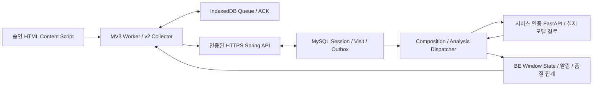

# 데이터 흐름과 저장 구조 — Issue #99

실제 코드는 `fe/src/v2`, `fe/real`, `be/src/main`, `ai/v2`, `ai/collection_main.py`와 Flyway V1~V16을 기준으로 합니다. 현재 실제 수집은 BLOCKED이며 아래 구현 경로의 통제된 합성 실행과 실제 참여자 수집을 구분합니다.

## FE와 수집 경계

`real/content.ts`는 매 관측 전에 Worker에 `v2-context`를 요청합니다. Worker는 인증/동의/배포 정책/허용 사이트/활성 세션을 검사한 뒤에만 추출을 허용합니다. DOM 검사는 기존 `content/extraction.ts`, Google/Naver 자연 검색 결과는 `content/search.ts`, URL 검사·정규화는 `shared/url.ts`를 재사용합니다. 폼 값은 읽지 않습니다. 수집 정책 조회가 실패/폐기되어도 인증된 정책 조회·철회 화면은 유지하며 collectionEnabled만 false로 닫습니다. 민감 텍스트 검사를 실패한 snapshot은 Worker에 전달하지 않습니다. 초기 추출 실패는 원문/가짜 체류시간/Visit 없이 failure 식별자만 영속화·집계하고 동일 활성 문서의 실패 관측을 중복 생성하지 않습니다. 제목500·본문5,000 code points, 검색어500의 기존 한도를 지킵니다. 원 URL은 순간 검증에만 사용하고 POST에는 query·fragment를 제거한 URL을 저장합니다. 검색어가 민감 URL query이면 검사에서 먼저 거절합니다.

Worker는 top frame, extension sender ID, active document lifecycle, `documentId`, `webNavigation.getFrame`의 현재 URL, Chrome 권한을 독립 확인합니다. SPA는 같은 문서의 현재 frame URL을 사용합니다. MessageSender의 최초 문서 URL을 현재 URL로 가정하지 않습니다. 제목/본문 해시로 콘텐츠 세대를 나누고 변경된 본문은 이전 Visit의 불변 POST를 덮어쓰지 않습니다. navigation revision이 바뀐 지연 관측은 버립니다. 권한 제거나 민감 DOM 발견은 격리·회수 경로로 연결됩니다. 허용 목록 밖 문서는 추출하지 않습니다.

활성 창/탭·visible 문서만 측정하며 monotonic clock와 wall clock가 불일치하거나 관측 gap>1,500ms면 간격을 버립니다. Worker/브라우저 재시작 후 과거 시간을 보간하지 않습니다. 5,000ms 최초 유효화 시 UUID v4 Visit과 sequence를 영속 확정합니다. 같은 대상4,000ms 미만 복귀는 누적, 이상은 새 Visit. 최초300,000ms 도달·이탈·종료의 행동 PATCH, size3/stride1은 기존 Collector를 그대로 사용합니다.

`CollectionSitePolicy`는 정확한 단일 `real-collection` 프로필, read-only 승인 JSON의 기간/근거/사이트, 그 파일 바이트의 SHA-256에 대한 `collection_release`의 독립 승인·미폐기 행을 요구합니다. 현재 동의 정책 ID/버전도 일치해야 합니다. FE 빌드에 정책 digest·buildId·정확한 사이트 범위를 묶고 서버 응답과 비교합니다. 세션 생성 시 `X-Collection-Build`를 검사하고 `session_collection_scope`에 고정합니다. 승인 파일/DB 기록을 자동 생성하는 운영 API는 없습니다. 배포 ID는 서버가 검증하는 클라이언트 선언이며 하드웨어 attestation은 아닙니다. 기관·연구 승인 판단 자체는 담당자의 책임입니다.

## IndexedDB와 전송

DB 이름 `focus-recovery`, version2, object stores `state`(v1), `v2`, `v2-receipts`입니다. v1 원본은 유지합니다. `v2/current`에는 format2/checkpoint revision, owner(participantId/consentId), lifecycle, start 멱등 요청, session, 후보·시간·sequence, `posts.entries`, `behaviors.entries`, `end`, notifications, retractions, withdrawal, quarantine가 있습니다. 종료 후 새 세션은 이전 checkpoint를 `v2/session/{sessionId}`에 archive합니다. 정리된 정상 Visit의 최소 영수증은 `v2-receipts/{sessionId}/{visitId}`에 저장합니다.

strict readwrite transaction 완료·revision CAS 전에 전송하지 않습니다. sending을 영속한 후 HTTP, ACK 확인 후 다시 영속합니다. POST는 순서대로 보내고 동일 visitId/원본 재전송을 사용합니다. PATCH는 POST ACK 이후 누적값·behaviorVersion을 검증합니다. END는 POST/PATCH drain 후 finalBehaviors를 보냅니다. 응답 유실 시 기존 end 상태를 조회하며 새 sessionId를 만들지 않습니다. 재시작의 sending은 pending으로 복구합니다. compact는 전송/복귀/회수 조건을 만족한 정상 원문만 최소 영수증으로 바꿉니다. 격리 원문·archive를 임의 삭제하지 않습니다.

Credential은 `chrome.storage.session`의 trusted-context 전용 `focus.accessCredential`에만 저장합니다. IndexedDB/local/sync에는 넣지 않습니다. 계정 전환 시 기존 owner와 다르면 이전 Queue를 보존·차단합니다. 완전히 drain된 종료 세션 다음에만 다른 계정의 새 세션으로 이동할 수 있습니다. Chrome 전체 종료 후에는 재인증합니다.

## HTTP 계약

사용자 API는 Bearer 불투명 Credential, HTTPS, DB 소유권·현재 Credential·동의를 검증합니다. test 단일 프로필의 loopback HTTP 예외는 합성 전용입니다. AI로는 별도 서비스 Token만 전달합니다. redirect/credential cookie는 사용하지 않으며 응답은 no-store입니다. 상세 DTO는 [v2 Schema](../contracts/v2/v2.schema.json), [인증 계약](../contracts/auth-consent-api.md), [운영 계약](../contracts/collection-operations-api.md)을 따릅니다.

| 실제 Endpoint | 요청 및 성공 ACK |
| --- | --- |
| GET `/api/auth/me` | `{participantId,expiresAt}` |
| POST `/api/auth/logout` | 현재 Credential 폐기,204 |
| GET/POST `/api/consent` | 상태 / `{requestId,policyId,policyVersion,accepted:true}` → 상태 |
| GET `/api/collection/site-policy` | 인증 필요. `{digest,buildId,policyId,policyVersion,status,expiresAt,sites:[{origin,pathPrefix}]}`. 미승인409 |
| GET `/api/collection/assignments`, `/api/collection/progress` | 본인 배정 / 본인 메타데이터 품질·진행률 |
| POST `/api/collection/assignments/{plannedId}/start` | `{}` + Idempotency-Key + 실제 빌드의 X-Collection-Build →201 WorkSessionResponse |
| POST `/api/sessions` | 기존 v1/합성 생성. real-collection v2는 배정 경로 사용을 강제 |
| GET `/api/sessions/{sessionId}` | 본인 세션 상태 |
| POST `/api/sessions/{sessionId}/visits` | visitId,sequence,browserTabKey,normalizedUrl,domain,title,content,searchQuery,isSearchResultPage,visitedAt,activeDurationMs,tabSwitchCount,behaviorVersion,extractionStatus →201/200 저장/replay |
| PATCH `/api/sessions/{sessionId}/visits/{visitId}/behavior` | activeDurationMs,tabSwitchCount,behaviorVersion → 최신 값/applied |
| POST `/api/sessions/{sessionId}/end` | finalBehaviors 또는 기존 빈 종료 요청 → WorkSessionResponse |
| GET `/api/sessions/{sessionId}/visits` | 방문 summary 페이지. 기본 검증에는 집계 API를 우선 |
| GET `/api/sessions/{sessionId}/analysis-status`, `/analyses`, `/analyses/{analysisId}` | v2 상태·분석 결과 및 현재/최근 성공 판단 |
| GET `/api/sessions/{sessionId}/windows/{windowId}/states` | stateVersion 기반 상태 이력 페이지 |
| PATCH `/api/sessions/{sessionId}/alerts/{alertId}/shown` | shownAt → 표시 ACK |
| POST `/api/sessions/{sessionId}/alerts/{alertId}/responses` | 선택·시각 → 선택 ACK |
| GET `/api/collection/attempts/current?workSession={id}` | 본인 attemptId |
| POST `/api/collection/attempts/{id}/failures`, `/delivered` | failureId/reasonCode/observedAt 또는 visitCount/lastSequence,204 |
| POST `/api/sessions/{sessionId}/visit-retractions` | retractionId/visitId/observedAt/reasonCode →202/200 QUARANTINED |
| POST `/api/consent/withdrawals` | requestId →202 전체 철회 영수증 |
| GET `/api/consent/withdrawals/{id}` | 본인 철회 Inventory·외부 미충족 항목 |

일반 오류는 `{code,message,fieldErrors}`이고 기존 v2 회수/AI envelope에는 apiContractVersion이 있습니다. 인증401, 타인 세션404, 권한403, 정책/동의/멱등 충돌409 등은 Queue를 삭제할 근거가 아닙니다. 원문 POST fingerprint 충돌, 낮은 sequence, 감소한 행동값, 같은 version의 다른 값은 거절합니다. Tombstone/격리는 replay보다 먼저 검사합니다.

## MySQL 실제 테이블

| 테이블 / PK | 주요 컬럼과 관계 |
| --- | --- |
| `participant` / participant_id | identity_reference_hash(별도 연결표 참조),status,created_at,withdrawn_at |
| `access_credential` / token_hash | participant_id FK,expires_at,revoked_at. 평문 저장 없음 |
| `consent_policy` / policy_id+policy_version | scope,purpose,collection_items,use_scope,retention_policy_ref,approval_ref,status,effective_at |
| `consent_record` / consent_id | participant_id FK, policy 복합FK,request_id,accepted_at,withdrawn_at. consent_event는 request/event 감사 |
| `work_session` / session_id | goal_text,status,started_at,ended_at,idempotency_key,collection_spec_version,owner_participant_id/consent_id FK, last_accepted_sequence,composed_through_sequence,privacy_revision,privacy_status,composition_dirty |
| `page_visit` / visit_id | session_id FK,sequence(세션별 UNIQUE),browser_tab_key,normalized_url,domain,title,content,search_query,is_search_result_page,visited_at,active_duration_ms,tab_switch_count,behavior_version,extraction_status |
| `analysis_window` / window_id | session_id FK,window_index(세션별 UNIQUE),window_size,start_visit_id/end_visit_id FK,api_contract_version,last_state_version,invalidated,decision_dirty,decision_error_code |
| `window_visit` / window_id+visit_id | 양쪽 FK,position(윈도별 UNIQUE). 유효 방문 순서의3개 |
| `analysis_result` / analysis_id | window_id UNIQUE/FK,processing_status,api_contract_version,input_fingerprint,input_snapshot,page_results,response_snapshot,model_versions,error_code,requested_at/analyzed_at/completed_at. v1 확률 컬럼 보존 |
| `compose_request` / compose_request_id | session_id FK,active_session_id UNIQUE,after_sequence,composed_through_sequence,privacy_revision,input_fingerprint,input_snapshot,response_snapshot,receipt,processing_status,claim_token,lease_until,next_attempt_at,attempts,error_code |
| `analysis_outbox` / analysis_id | analysis/session FK,privacy_revision,processing_status,claim_token,lease_until,error_code. 영속 분석 전달 작업 |
| `window_state_history` / window_id+state_version | analysis_id와 window 복합FK,rule_version,judged_at,final_state,behavior_snapshot,input_fingerprint UNIQUE. append-only 판단 버전 |
| `notification` / alert_id | session/window/state/analysis 참조,shown_at,invalidated_at; `notification_response`는 실제 선택 사실 |
| `collection_operator` / participant_id | authority_ref,granted_at,revoked_at. 별도 승인 역할 |
| `collection_audit` / event_id | actor_id FK,action,target_id,evidence_ref,occurred_at |
| `collection_plan` / plan_id | 단일행1,revision CAS |
| `collection_slot` / slot_id | A/B/C,participant_id UNIQUE/FK |
| `collection_goal` / goal_id | description,status,evidence_ref |
| `collection_assignment` / planned_session_id | goal_id/slot_id FK,scenario_type,repetition. 목표×시나리오×회차 UNIQUE |
| `collection_attempt` / attempt_id | planned_session_id FK,participant_id/session_id 복합FK,source,request_key,review_status,reason_code,delivered_visit_count,delivered_through_sequence,created_at |
| `collection_failure` / failure_id | attempt_id FK,reason_code,observed_at. 원문 저장 없음 |
| `collection_release` / policy_digest | build_id,approval_ref,authorized_at,revoked_at. V16에서 빈 테이블만 생성 |
| `session_collection_scope` / session_id | session FK,policy_digest release FK,build_id. 세션의 불변 수집 범위 |
| `privacy_retraction` / retraction_id | session_id FK,visit_id,reason_code,observed_at,requested_at,input_fingerprint,processing_status,prerequisites,error_code,attempts |
| `visit_tombstone` / visit_id | session_id/retraction_id FK,created_at. Visit FK가 없어 POST 전 철회도 보존 |
| `retraction_target` / retraction_id+target_type+target_id | processing_status,error_code,owner_role,evidence_code,verified_at,claim_token,lease_until,next_attempt_at,attempts |
| `consent_withdrawal` / withdrawal_id | participant_id UNIQUE/FK,requested_at,processing_status=QUARANTINED |
| `withdrawal_session` / withdrawal_id+session_id | 부모/세션 FK,processing_status,attempts,error_code |
| `withdrawal_retraction` / withdrawal_id+retraction_id | 부모/자식 회수 FK |

원문은 주로 page_visit 및 구성/분석 snapshot·상태의 파생 근거에 있습니다. 관리자 집계·SQL은 원문을 기본 출력하지 않습니다. V1~V15 migration 파일은 바꾸지 않고 V16만 추가했습니다.

## AI와 BE의 책임

BE는 유효 Visit ID/sequence의 ordered stream과 tail/cursor를 `POST /api/ai/window-compositions`에 전달합니다. AI가3/stride1을 구성하고 BE가 windowId/index를 발급·FK/receipt/outbox와 원자 저장합니다. 분석 `POST /api/ai/analyses`에는 원래 목표, 세 방문의 제목·본문·검색어·순서 등 기존 Schema의 입력을 보냅니다. Qwen3-Embedding-0.6B cosine 및 기존 Qwen3-4B tokenizer/CausalLM의 페이지 관련성 경로를 사용합니다. 임의 대체 모델은 없습니다. 실제 모델 미준비 시503/실패로 남기며 v1 fallback을 하지 않습니다.

AI는 각 페이지의 DIRECT/JUSTIFIED_DETOUR/UNRELATED·근거·모델 버전을 반환합니다. 의미 관련성 학습의 필수 입력에 체류시간을 추가하지 않습니다. BE는 실제 체류시간·탭 전환 및 최신 AI 결과로 suffix3 규칙의 최종 NORMAL/TRANSITION/DRIFT를 판단하고 stateVersion을 append합니다. 행동 PATCH는 포함 Window를 dirty로 만들고 동일 AI 결과로 상태만 재판단하며 Window/AI 호출을 늘리지 않습니다. 시나리오와 AI 라벨은 사람 정답이 아닙니다.

실제 배포 엔트리는 `collection_main:app`으로 v2만 공개하고 모델을 offline 로딩합니다. 서비스 Bearer, 단일 Worker, 영속 SQLite RetractionJournal이 필요합니다. journal 복원/장애가 있으면 fail-closed합니다. Compose는 DB/AI 포트를 외부로 열지 않습니다. `/health`의 READY는 모델 warm-up 성공이며 정확도·기관 승인 증거가 아닙니다.

## 장애·철회·복원

네트워크/ACK 유실은 동일 불변 요청 재전송, Worker/Chrome 재시작은 Queue 복원+재인증, 서버 재시작은 기존 compose/outbox claim·lease·receipt 복원으로 처리합니다. 구성 작업은 bounded retry/backoff, 분석 실패는 FAILED이며 성공 라벨로 채우거나 자동 v1 전환하지 않습니다. 현재 response130s/lease180s/margin15s·AI soft60s/lock60s는 실모델 처리량으로 승인된 값이 아닙니다.

철회는 participant 동의와 모든 소유 세션을 즉시 격리하고 window/analysis/outbox/알림을 무효화합니다. DB Payload scrub 및 AI journal/cache 무효화는 유효한 배포의 privacy 근거와 세션 scope가 있는 좁은 작업만 실행합니다. 만료·폐기된 배포, FE 원본/archive, 로그·Export·학습·백업 등 미확인 사본은 BLOCKED로 남습니다. `QUARANTINED`는 재수집/분석/재전송을 막는 상태이고 `PURGED`는 전체 사본·영향 제거의 증거가 필요합니다. PURGED 전이를 제공하지 않습니다.

[운영 가이드](operator-guide.md)의 백업·최신 철회 원장·offline 복원 절차를 따릅니다. `restore-quarantine.py`는 최신 원장으로 격리/동의철회/Tombstone를 재적용하는 SQL만 생성하고 모든 release를 폐기합니다. AI journal과 외부 사본까지 대조하기 전에 서비스를 열지 않습니다. SQL 생성이나 DB 적용만으로 전체 삭제 증거가 생기지 않습니다.

후속 `sessions/visits/windows/window_states/ai_predictions/human_labels/collection_failures.jsonl` 및 manifest는 sessionId/visitId/windowId/participantId/goalId/attempt의 source·scenario와 consent/privacy 상태를 연결해야 합니다. source=SYNTHETIC을 실제160실적에서 제외하고 학습 입력에는 불필요한 식별자를 빼며 AI 예측과 human_labels를 분리합니다. 전체 Export·라벨 UI·재학습은 이번에 구현하지 않았습니다.
