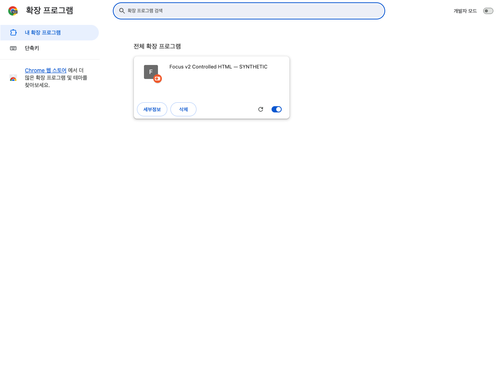
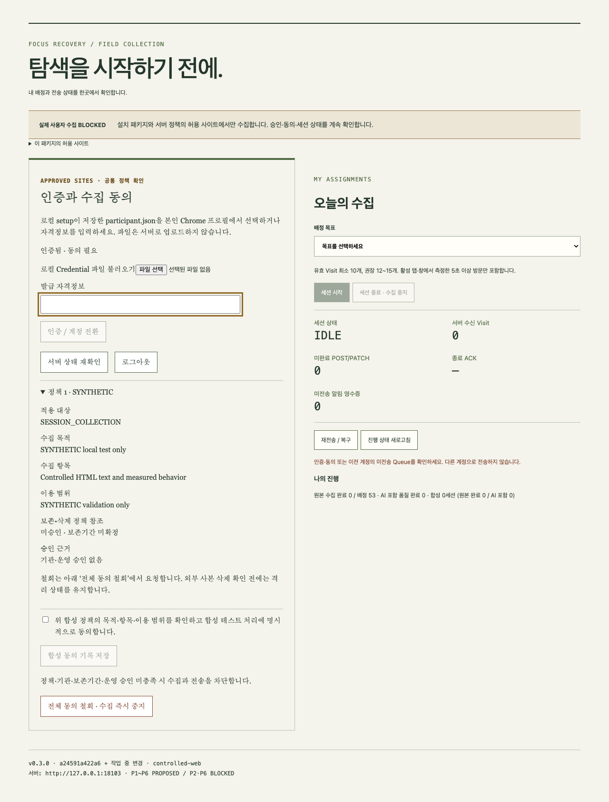
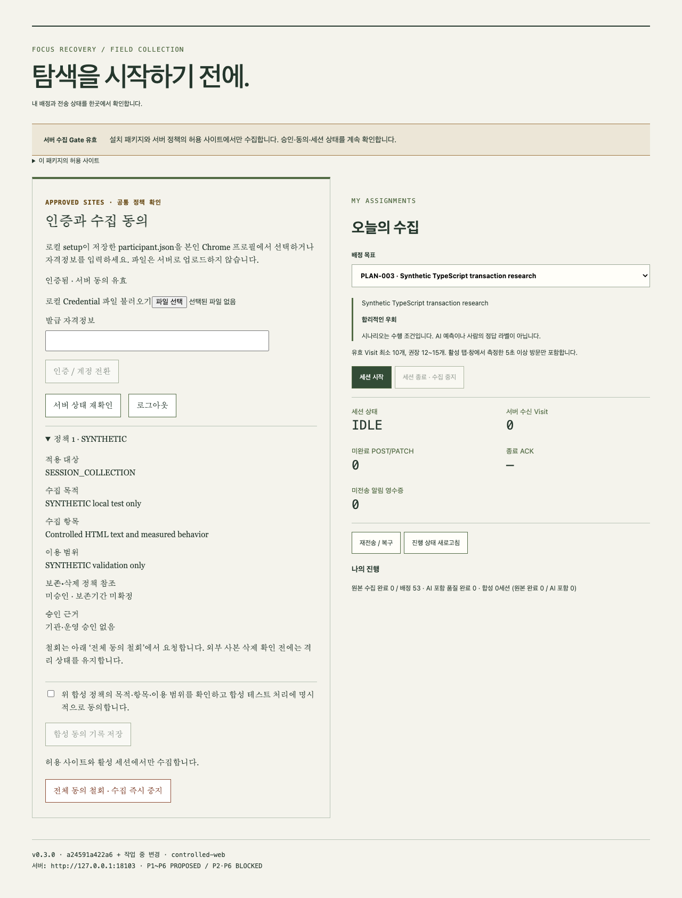
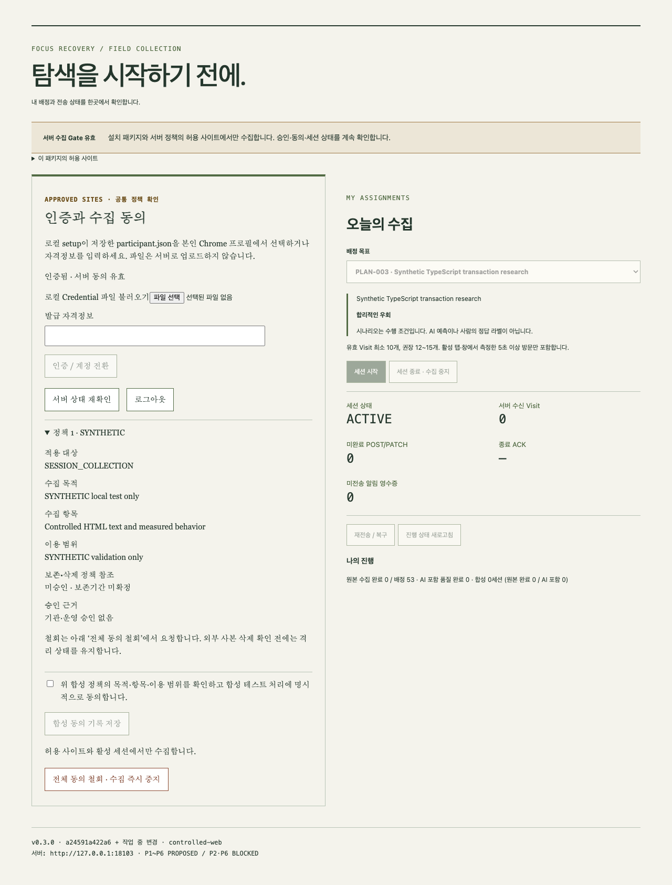
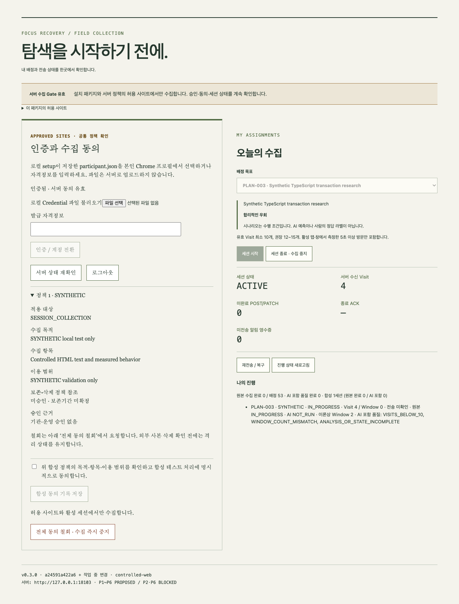
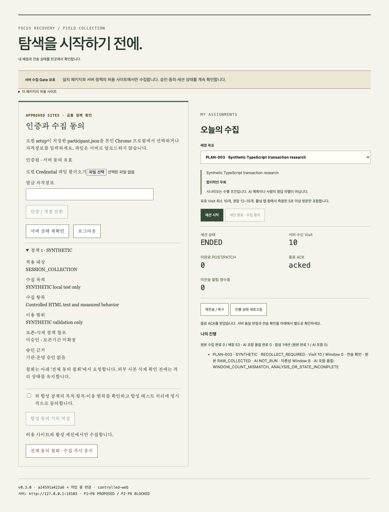
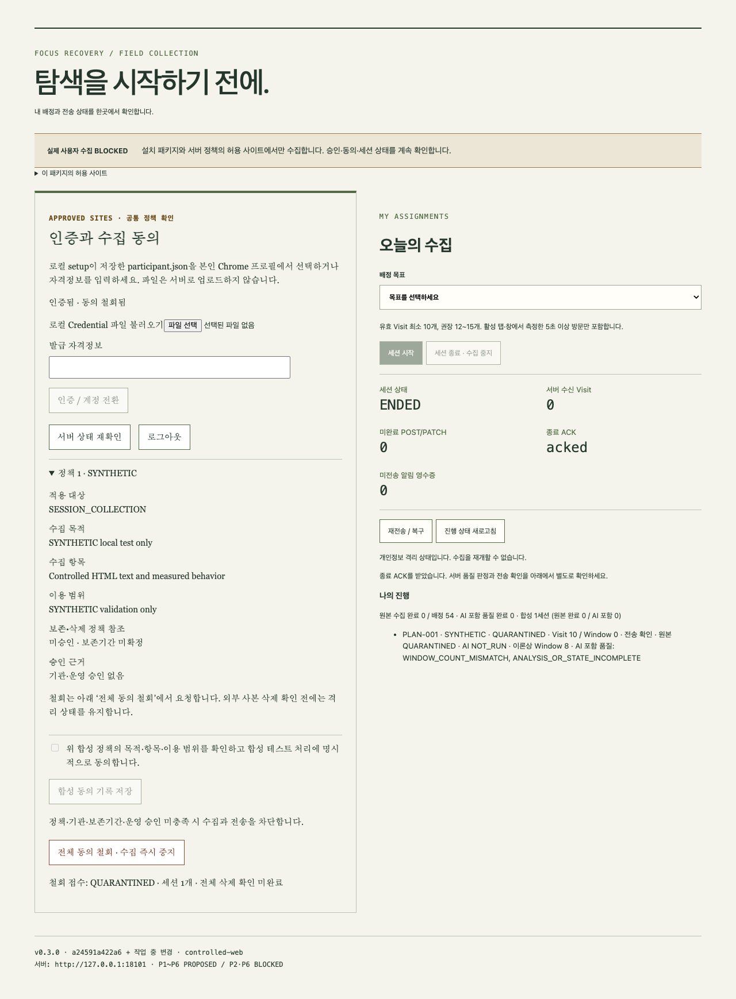
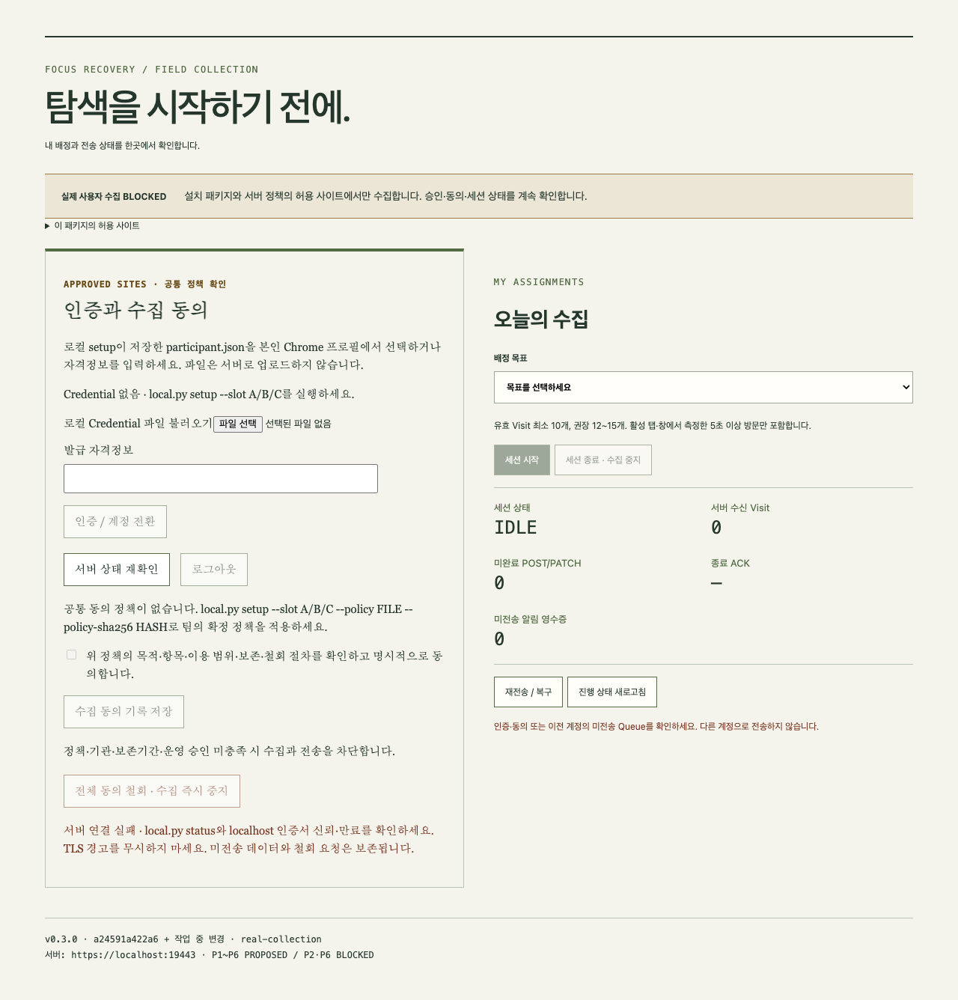

# 팀원용 데이터 수집 실습 매뉴얼 — A/B/C

현재 운영 준비 절차는 [최종 Readiness](real-collection-final-readiness.md)를 따른다. 정책 내용과90일 보존을 채택하고 Plan revision1을 준비했다. 실제 기록이 없는 목표 승인/기관 판단은 DRAFT/UNRESOLVED로 남긴다. 실제 증거 입력 후 `local.py policy-prepare`가 Java 검증을 통과한 공통 파일/SHA를 생성한다. 아래 #105/#106의 기존 수치·제안/검증 내용은 당시 기록이며 최신 JSON은 접근 가능한15쌍으로 정리했다.

#105의 현재 로컬 정책은 [공통 정책 권고안](real-collection-policy.md)과 [TEAM_POLICY.json](TEAM_POLICY.json)을 기준으로 한다. **DRAFT/UNRESOLVED·실제 개시 BLOCKED**는 유지한다. [정책 적용 절차](policy-application-guide.md), [목표20개 원문/완료 기준/시나리오](confirmed-goals-proposal.md), [사이트 검토](site-collection-review.md), [이번 실행 결과](issue105-validation.md)를 먼저 확인한다. 원본문장/검색어/제목 대신 행동·불투명 URL 식별자·고정 Topic만 저장한다. 기존 v1/AI 활성 경로의 본문 규격과 구분한다.


## #103 셀프 초기화 사용 경로

최신 설치·25단계 수행 항목과 실제 명령은 [A/B/C 셀프 초기화 매뉴얼](individual-local-setup.md)을 따른다. 각자 `python3 tools/individual-local/local.py setup --slot A`(B/C는 자기 슬롯) → 공통 확정 정책/hash 적용 → `build` → 본인 Chrome 프로필에서 **로컬 Credential 파일 불러오기** → 본인 `participant.json` 선택 → 정책/보존/민감페이지 처리 확인 → 직접 동의 → 배정 선택 → 시작/10 Visit/종료 ACK/RAW_COLLECTED → 암호화 Export 순서다. Windows는 `python`을 사용한다.

로컬 화면은 슬롯·HTTPS 연결·Credential 준비·정책 SHA-256·정책 없음/DRAFT/만료/무결성·목표 미확정·미동의·철회 차단 사유를 표시한다. 빌드 digest가 다르면 재빌드 안내 후 시작을 막는다. Credential은 표시/캡처하지 않고 session storage에만 연결한다. Chrome 전체 종료 후 파일을 다시 선택한다. 만료/폐기는 `setup --slot A --rotate-credential` 후 재로그인한다.

완료량 부족 시 종료 후 **재수집 사유** 선택 → **사유 기록 후 재수집 허용** → 같은 PLAN의 새 시도로 수행한다. 본인 종료·CLEAR 세션만 가능하며 원래 시도는 남는다. 전체 철회 후 수집은 재활성화하지 않는다. 최신 privacy 전달을 위한 인증만 재발급할 수 있다. 새 검증/캡처와 NOT_CAPTURED 항목은 [#103 검증 보고](local-self-setup-validation.md)에 있다. 아래 #101 실습 화면은 기존 흐름 설명이며, 실제 승인/기관/보존/최종 목표가 확정되었다는 뜻이 아니다.


**실제 참여자 수집: BLOCKED.** 설치 준비는 할 수 있지만 실제 동의·목표·사이트·기관·보존/회수·시작 승인과 로컬 공통 정책 적용(운영 모드는 독립 Release)가 완료되기 전에는 실제 웹 탐색 데이터를 수집하지 않습니다. 현재 저장소의 목표20개는 DRAFT입니다. [설치 가이드](individual-local-setup.md), [Readiness](readiness-checklist.md), [실행 증거와 미검증 항목](individual-local-validation.md)을 함께 확인하세요.

아래 이미지는 **개인정보 없는 통제 HTML·임시 Chrome 프로필·독립 테스트 MySQL로 실제 실행한 SYNTHETIC/TEST 화면**입니다. 실사용 승인 화면이나 실제 참여자 실적이 아닙니다. 버튼은 실제 Extension의 버튼입니다. 화면의 테스트 서버 포트18101은 실수집 기본 HTTPS9443과 구분합니다.

## 1. 데이터 수집 목적

작업 목표와 실제 탐색 흐름의 관계를 후속 연구·라벨링에서 살펴보기 위한 원본 수집입니다. 원본 수집에는 FastAPI나 AI 모델이 필요하지 않습니다. AI 예측이나 사람이 붙인 정답을 만들어 넣지 않습니다.

## 2. 수집 대상과 참여자

개발팀원 A/B/C가 자기 PC에서 자기 Credential과 배정만 사용합니다. 계획은 A54/B53/C53, 목표20개×4시나리오×2회=160세션입니다. 합성 테스트는 실제160세션 실적에 포함하지 않습니다.

## 3. 수집하는 데이터

가명 참여자·목표/계획/시도 ID, 도메인·세션별 HMAC 페이지 식별자, 원제목 대신 고정 Topic, 본문 대신 METADATA_ONLY 표식, 검색어 대신 [NOT_COLLECTED] 표식, Visit ID/순서/시각, 활성 체류시간·탭 전환·행동 버전, 추출/전송/종료 영수증, 동의 정책 참조·개인정보 상태를 저장합니다. 원본 전용 모드의 AI 결과는 **미실행**입니다. RAW_ONLY에서는 rawStatus=RAW_COLLECTED와 END ACK로 원본 성공을 확인합니다. 별도 AI 포함 품질의 RECOLLECT_REQUIRED/미완료는 AI를 실행하지 않은 결과일 수 있으며 원본 실패와 같지 않습니다.

## 4. 수집하지 않는 정보

실명·이메일·Credential·비밀번호·폼 입력·쿠키·개인 프로필을 연구 데이터로 수집하지 않습니다. 로그인/계정/결제/은행 등 민감 URL·DOM·텍스트, 허용되지 않은 사이트는 차단합니다. 개인정보가 있는 페이지를 일부러 열어 차단을 시험하지 않습니다. 개인 메시지·메일·마이페이지·주문 화면에서는 수집을 수행하지 않습니다.

## 5. macOS·Windows 준비

[개인 PC 설치 가이드](individual-local-setup.md) 1~4절대로 Git/JDK21/Docker/Node/Python/age/Chrome과 localhost 인증서를 준비합니다. Windows 명령에서 `python3` 대신 `python`, Gradle은 `.\gradlew.bat`를 사용합니다. Windows 실제 설치·신뢰·수집은 **NOT_TESTED**입니다.

## 6. 프로젝트 파일 준비

같은 가이드의 신규 clone/브랜치/`npm ci`/`bootJar` 준비 후 본인 슬롯으로 셀프 초기화합니다. B/C는 자기 슬롯입니다. 같은 슬롯 setup은 기존 UUID/데이터를 유지합니다. 공통 확정 정책/hash 적용은 [정책 적용 가이드](policy-application-guide.md)를 따릅니다. Secret이나 Export를 Git으로 전달하지 않습니다.

macOS:

```sh
python3 tools/individual-local/local.py setup --slot A
```

Windows PowerShell (**NOT_TESTED**):

```powershell
py -3 tools/individual-local/local.py setup --slot A
```

## 7. Docker/MySQL 실행

setup이 자기 MySQL을 시작합니다. 이후 중지한 자기 환경을 다시 켤 때는 Docker Desktop을 켜고 저장소 루트에서 실행합니다.

```sh
python3 tools/individual-local/local.py db
```

자기 전용 project의 persistent volume이 시작되어야 합니다. 다른 PC의 주소나 MySQL 계정은 필요하지 않습니다.

## 8. Spring Boot 실행

setup이 자기 HTTPS Backend도 시작합니다. 이후 중지한 자기 환경을 다시 켤 때 실행합니다.

```sh
python3 tools/individual-local/local.py start
```

`Backend starting on https://localhost:9443` 다음 단계에서 실제 health를 확인합니다. AI 서버는 시작하지 않습니다. 관리자 등록·승인 정책을 자동 생성하는 명령이 아닙니다.

## 9. 로컬 HTTPS·인증서 설정

자기 PC에서 만든 `tls/localhost.cer`의 지문을 확인해 macOS 로그인 키체인 또는 Windows 현재 사용자 신뢰 저장소에 설치합니다. Chrome을 다시 시작하고 인증서 경고가 없음을 확인합니다. 경고 무시·검증 해제는 금지합니다. 다른 사람의 PKCS12나 개인키를 받지 않습니다.

## 10. 서버 정상 실행 확인

```sh
python3 tools/individual-local/local.py status
```

`HTTPS health: 200`과 자기 MySQL의 healthy를 확인합니다. health만 성공하고 **실제 사용자 수집 BLOCKED**가 표시되는 것은 승인 전 정상 동작입니다. 로그/포트/TLS 오류는 설치 가이드 8절대로 확인합니다.

## 11. Chrome Extension 설치·활성화

```sh
python3 tools/individual-local/local.py build
```

설치용 ZIP은 `fe/packages`, 압축 해제된 설치 폴더는 `fe/dist-real`입니다. Chrome의 별도 수집 프로필에서 `chrome://extensions`를 엽니다. 개발자 모드를 켜고 **압축해제된 확장 프로그램을 로드합니다**로 해당 폴더를 선택합니다. Chrome 언어/버전에 따라 버튼 번역이 조금 다를 수 있습니다. 활성화 스위치를 켜고 툴바에 아이콘을 고정합니다.



합성 E2E에서는 Chrome for Testing을 실행하며 개발자용 로드 옵션으로 실제 MV3 Extension을 설치했습니다. 위 이미지는 그 **실제 확장 관리 화면**입니다. 수동 설치 버튼 클릭을 재현했다는 증거는 아닙니다. 일반 참여자는 위 수동 설치 순서를 따릅니다.

## 12. Extension 로그인

아이콘을 눌러 수집 화면을 열고 **로컬 Credential 파일 불러오기**에서 setup이 자기 PC에 저장한 `.collection/local/participant.json`을 선택합니다. 화면의 `인증됨`·자기 A/B/C 슬롯·HTTPS 연결·공통 정책 SHA-256을 확인합니다. 파일은 서버로 업로드되지 않으며 Token은 trusted-context session storage에만 연결됩니다. 별도 관리자 발급 없이 진행합니다. Credential 파일/값을 촬영하거나 단체 채팅에 보내지 않습니다.


이 화면은 실제 코드의 로그인 화면입니다. 테스트 서버와 SYNTHETIC 정책을 사용하는 경우에도 실제 사용자 수집 승인으로 해석하지 않습니다.

## 13. 개인정보 동의 확인

정책 펼침 영역에서 수집 목적·항목·이용 범위·보존/삭제 참조·철회 방법·승인 근거를 읽습니다. 실제 참여 시에는 승인된 정책에 본인이 명시적으로 동의한 뒤 **수집 동의 기록 저장**을 누릅니다. `서버 동의 유효`가 표시되어야 합니다. 내용을 이해하지 못했거나 근거가 없으면 동의하지 않고 담당자에게 확인합니다.



사진은 **SYNTHETIC**이라 버튼명이 **합성 동의 기록 저장**이며 기관/운영 승인 없음이 표시됩니다. 실제 동의 기록을 대신하지 않습니다. 서버·설치 패키지의 승인 정책도 일치해야 세션 시작이 가능합니다.

## 14. 배정된 목표와 시나리오 확인

**배정 목표**에서 자기 PLAN을 선택합니다. 시나리오는 해당 PLAN에 이미 배정되어 표시되며 **독립된 자유 선택 버튼은 없습니다**. 목표 유지/합리적인 우회/점진적인 이탈/명확한 이탈 중 표시된 안내를 따릅니다. 미확정 목표는 시작할 수 없습니다.



실제 테스트에서 A는 `GOAL-001 / PLAN-001 / 목표 유지`, B는 `PLAN-002 / 목표 유지`, C는 `PLAN-003 / 합리적인 우회`였습니다. 합성 목표 문자열은 `Synthetic TypeScript transaction research`입니다. 실제 팀 목표20개를 확정한 예시가 아닙니다. 실제 B/C는 자기 서버에서 반환한 배정을 사용합니다.

## 15. 세션 시작

본인 배정·목표·허용 사이트·동의·Gate가 모두 유효하면 **세션 시작**을 한 번 누릅니다. 세션 상태가 `ACTIVE`가 되어야 합니다. 버튼이 비활성이거나 요청이 거절되면 새 ID를 만들거나 설정을 바꾸어 우회하지 않습니다.



## 16. 웹 탐색 수행

패키지의 **이 패키지의 허용 사이트**를 확인하고 승인된 공개 페이지에서만 탐색합니다. 실제 활성 탭/창에서 5초 이상 머물고 메타데이터/개인정보 검사를 통과한 방문만 유효합니다. SUCCESS는 메타데이터 생성 성공이며 본문 수집 성공을 뜻하지 않습니다. 같은 URL에 4초 미만 복귀하면 기존 Visit에 누적하고 4초 이상이면 새 Visit가 됩니다. 최초 활성5분에는 Behavior PATCH가 전송됩니다. 시간을 수동으로 늘리거나 수집 코드를 개발자 도구로 조작하지 않습니다.

합성 E2E는 `http://127.0.0.1:8911/public/page-1`부터 `page-10`까지 직접 탐색했습니다. 이 서버는 테스트 실행 중에만 존재하며 **실제 수집용 사이트가 아닙니다**. 일반 인터넷 사이트에서 시험하려면 사전 승인된 목록과 별도 파일럿이 필요합니다.

## 17. 유효 Visit와 전송 Queue 확인

화면의 **서버 수신 Visit**는 IndexedDB에만 생긴 후보 수가 아니라 ACK를 받은 Visit 수입니다. 최소10개, 권장12~15개를 확보합니다. **미완료 POST/PATCH**가 있으면 원본과 행동 정보가 아직 서버에 확정되지 않았을 수 있습니다. 수집 창을 보는 동안에는 탐색 페이지가 비활성화되므로 체류시간이 늘지 않습니다.



## 18. 세션 종료

**세션 종료 · 수집 중지**를 누릅니다. POST/PATCH와 최종 행동 값을 먼저 전송한 뒤 END가 전송됩니다. `END_PENDING`이면 창을 닫거나 Extension을 삭제하지 않고 기다립니다. `ENDED`, `종료 ACK: acked`, 미완료 POST/PATCH0을 확인합니다.

## 19. 원본 수집 완료 확인

**진행 상태 새로고침**을 눌러 해당 PLAN에 다음을 모두 확인합니다.

- `원본 RAW_COLLECTED`
- `Visit 10` 이상과 `전송 확인`
- 로컬 미완료 POST/PATCH0, 종료 ACK `acked`
- 원본 전용 모드에서는 `AI NOT_RUN`, 생성 Window0



이 합성 화면은 `원본 완료 1 / AI 포함 0`이며 실제 실적은0입니다. 기존 `QUALITY_PASSED`는 Window/AI/상태 이력까지 요구합니다. 따라서 원본 수집이 정상이어도 AI 미실행이면 기존 AI 포함 품질 상태는 `RECOLLECT_REQUIRED`일 수 있습니다. **원본 RAW_COLLECTED와 AI NOT_RUN이 정상인 원본 전용 수집을 AI 미실행 때문에 다시 수집하지 않습니다.** 개인정보 격리는 항상 완료보다 우선합니다.

## 20. 서버 저장 상태 확인

참여자는 위 본인 진행 화면을 확인하고, 로컬 저장 집계가 필요하면 실행합니다. 본문·검색어·Credential은 출력하지 않습니다.

```sh
python3 tools/individual-local/local.py verify
```

자기 세션의 저장 Visit 수와 sequence 유일성, 종료/격리 상태를 확인합니다. 정확히10개의 유효 Visit면 이론상 size3/stride1 Window는8개입니다. 원본 전용 모드에서 실제 생성0·AI분석0은 정상입니다. sequence 공백은 허용합니다.

## 21. 다음 세션 진행

종료/전송 ACK와 원본 완료를 확인한 뒤 다음 배정 PLAN을 선택합니다. 이미 시작한 PLAN을 반복 시작하면 거절됩니다. 계획 전체 수와 자기 완료 수, 합성 수를 혼동하지 않습니다. 세션 종료 후 서버를 끄려면 `local.py stop`을 사용합니다. 다음 날 `db` → `start` → 본인 재인증 순서로 재개합니다.

## 22. 수집 실패와 재수집

원본 `RECOLLECT_REQUIRED`, 유효 Visit 부족, 추출 실패, 미전송·저장 오류를 확인하면 현재 ID와 기록을 보존하고 담당자에게 원문 없는 상태/오류코드만 전달합니다. 담당자는 기존 Attempt에 `FAILED` 또는 `RECOLLECT_REQUIRED`와 근거를 기록한 뒤 같은 PLAN의 새 Attempt를 허용합니다. 이전 시도를 삭제하거나 다른 PLAN으로 바꾸지 않습니다. 새 시도도 최소10 Visit가 필요합니다.

네트워크 장애 뒤에는 동일 계정으로 **재전송 / 복구**를 누릅니다. 자동 재시도 한도가 끝났다면 같은 버튼으로 명시적으로 재시도합니다. Chrome/Worker가 재시작되면 IndexedDB는 남지만 Credential은 다시 입력해야 할 수 있습니다. 본인으로 재인증한 후 Queue를 복구하고 누락을 확인합니다.

통제된 합성 E2E에서는 업로드 오류 뒤 같은 원본/ID를 재전송해10 Visit를 저장했습니다. 개인 사이트나 실제 참여자 데이터로 장애 실험을 하지 않았습니다.

## 23. 데이터 Export

운영 모드에서 관리자가 `age-keygen`으로 만든 **공개 수신키**(`age1...`)만 받습니다. 개인 복호화 키는 받거나 공유하지 않습니다. 수집을 종료하고 Queue0·ACK·원본 완료를 확인한 뒤 실행합니다. 아래 변수에는 담당자가 전달한 공개키를 넣습니다. Credential 파일은 발급 시 받은 보호 JSON입니다.

```sh
read -r AGE_RECIPIENT
python3 tools/individual-local/dataset.py export \
  --server https://localhost:9443 --ca-file .collection/local/tls/localhost.pem \
  --credential-file .collection/local/participant.json \
  --recipient "$AGE_RECIPIENT" --output .collection/local/A-001.tar.age
```

```powershell
$recipient = Read-Host '관리자의 age 공개 수신키'
python tools/individual-local/dataset.py export --server https://localhost:9443 --ca-file .collection/local/tls/localhost.pem --credential-file .collection/local/participant.json --recipient $recipient --output .collection/local/A-001.tar.age
```

B/C는 출력 이름을 바꿉니다. `exportId`, `encrypted: true`, 파일 SHA-256이 출력되어야 합니다. 기존 출력은 덮어쓰지 않습니다. 실제 데이터에 `--synthetic-plaintext`나 `--synthetic-loopback`을 사용하지 않습니다. 서버에 Export 감사 메타데이터가 남고 실제 파일에는 Credential/실명/이메일을 넣지 않습니다.

## 24. Export 파일 무결성 확인

방금 출력된 암호문 SHA-256을 보관하고 파일을 다시 계산합니다.

```sh
shasum -a 256 .collection/local/A-001.tar.age
```

```powershell
Get-FileHash .collection/local/A-001.tar.age -Algorithm SHA256
```

두 값이 같아야 합니다. 내부 Manifest/행 수/파일별 checksum·FK 검사는 개인 복호화 키를 가진 운영 모드에서 관리자가 [통합 매뉴얼](merge-guide.md)의 `dataset.py verify`로 수행합니다. 참여자에게 관리자의 개인키를 요청하지 않습니다.

## 25. 안전한 파일 전달

암호화된 `.tar.age`만 승인된 비공개 전달 경로로 보냅니다. Export ID/암호문 SHA-256/슬롯/Plan revision과 수신자를 별도로 기록합니다. 관리자는 **인증된 별도 경로**로 Export SHA-256을 확인해야 합니다. age 수신 공개키로 암호화되었다는 사실만으로 파일 작성자가 증명되지는 않습니다. GitHub·공개 채팅에 원본/Export/Secret을 올리지 않습니다.

통합 직전 담당자는 자기 서버에서 최신 개인정보 상태를 새로 받아 별도 해시를 전달해야 합니다. 15분을 넘었거나 서버/담당자의 최신 여부를 확인할 수 없으면 통합이 차단됩니다. 담당자가 연결할 수 없는 PC의 파일을 추측으로 포함하지 않습니다.

## 26. 수집 중단과 전체 동의 철회

현재 세션만 끝내려면 **세션 종료 · 수집 중지**를 사용합니다. 전체 동의를 철회하려면 **전체 동의 철회 · 수집 즉시 중지**를 누릅니다. 오프라인이면 철회 요청이 로컬에 보존되므로 연결 복구 후 본인으로 재인증하여 전송합니다. 로그아웃·Credential 폐기는 철회 요청을 대신하지 않습니다.



`동의 철회됨`, `QUARANTINED`, 전체 삭제 확인 미완료를 확인합니다. 소유 세션은 즉시 격리되고 원본 완료 실적에서 제외됩니다. 관리자에게 Export 수신자·백업·통합 데이터셋·후속 학습 사본의 회수를 요청합니다. 새 개인정보 상태로 재통합하면 기존 Export의 해당 세션도 제외됩니다. **과거에 배포한 파일 자체가 자동 삭제되지는 않습니다.** 담당자가 사본 대장에 격리/삭제 증거를 남겨야 하며 전체 증거 없이 PURGED가 되지 않습니다.

## 27. 자주 발생하는 오류



이 이미지는 **DRAFT/수집 차단 패키지 + 임시 프로필**에서 실제 로그인 요청을 시험한 화면입니다. Chrome에 localhost 인증서를 아직 신뢰 설치하지 않아 서버 연결 실패 안내가 표시됐습니다. 입력 Credential은 테스트용 잘못된 문자열이며 촬영 전에 비웠습니다. 인증서를 무시해서 성공 상태로 만든 화면이 아닙니다.


| 화면/상태 | 할 일 |
| --- | --- |
| 실제 사용자 수집 BLOCKED / 세션 시작 비활성 | 승인·동의·목표·허용 사이트·빌드 정책·로컬 공통 정책 적용(운영 모드는 독립 Release)를 담당자와 확인. 우회 금지 |
| 인증정보 만료 | 본인 Credential 갱신·재인증. 계정 전환으로 과거 Queue 전송 금지 |
| Visit 수가 증가하지 않음 | 허용 공개 페이지·활성 탭/창·실측5초·메타데이터/민감 DOM 검사 확인. 검색창 등 입력 중에는 수집 중단/격리될 수 있으므로 수집용 페이지에서는 입력하지 않음. 화면 전환 중 체류시간은 증가하지 않음 |
| 미완료 POST/PATCH / END_PENDING | 서버/TLS·네트워크 확인 → 재전송 / 복구. IndexedDB/Extension 삭제 금지 |
| 저장 오류로 안전 중지 | 디스크·브라우저 저장소 권한·로그 확인, 현재 원본 보존 후 담당자에게 상태 전달 |
| 원본 완료, AI NOT_RUN | 원본 전용 모드의 정상 결과. 이론상 Window와 실제 생성/분석 수를 구분 |
| Export 거절 | 신규 출력 경로·본인 인증/동의·현재 수집 승인·수신 공개키 확인 |
| Import privacy stale/rollback | 담당자가 원본 PC의 최신 개인정보 상태를 다시 확인. 오래된 상태로 레지스트리를 덮지 않음 |
| QUARANTINED | 재수집/재수입하지 않음. 담당자와 사본 회수·안전한 보관/삭제 절차 진행 |

실제 문의 담당자·연락 경로는 운영 책임자가 참여 전에 별도로 제공해야 합니다. 현재 저장소에는 실제 담당자 연락망과 기관·보존/삭제 승인이 없어 실제 개시는 BLOCKED입니다.
