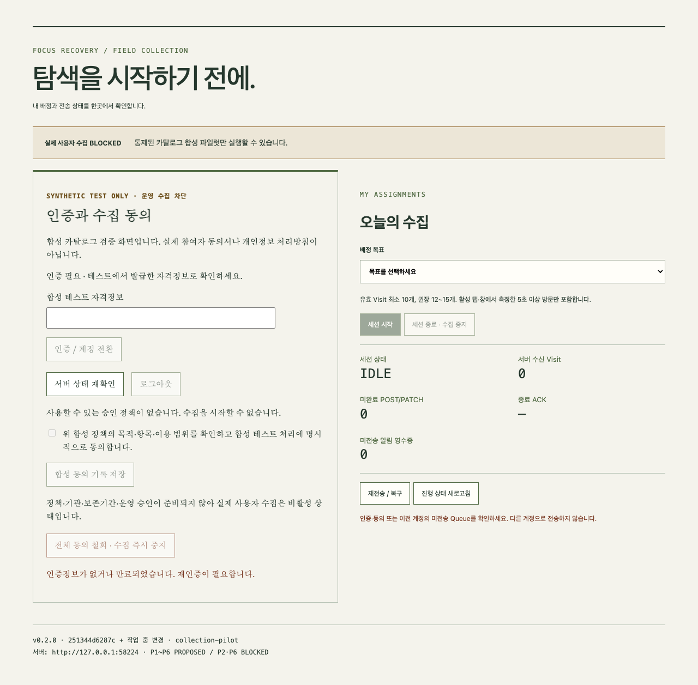
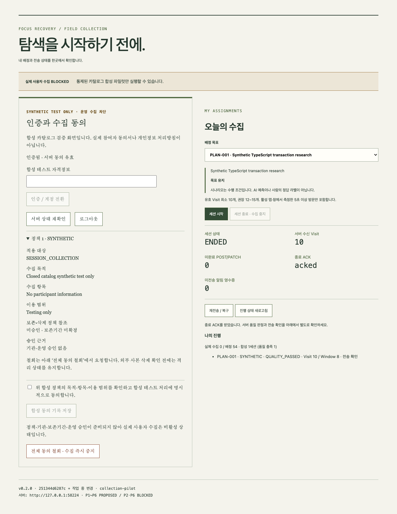
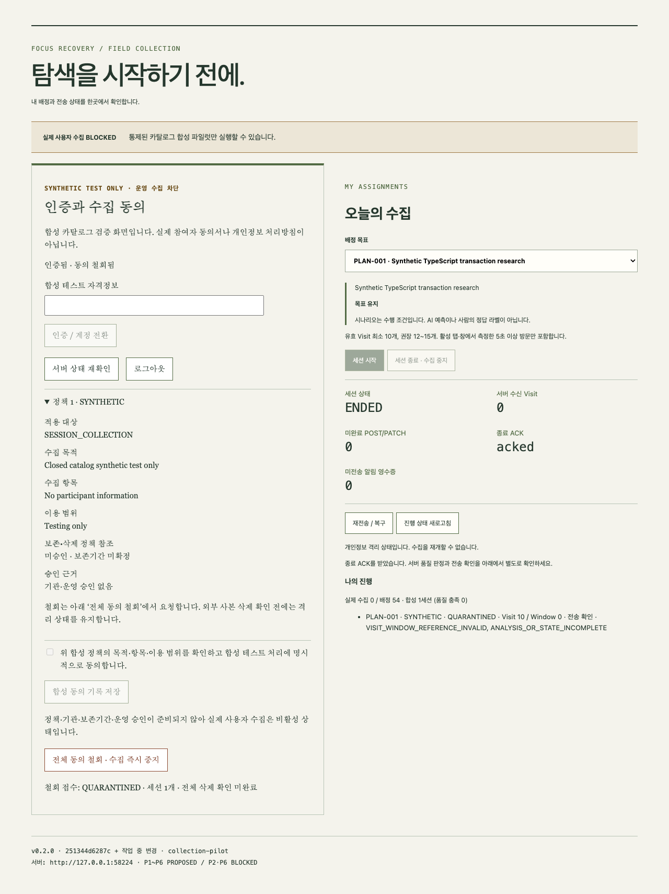

# 개발팀원 참여자 안내서

이 안내서는 Issue #97의 **참여 준비 패키지**와 **합성 파일럿 패키지**의 실제 화면을 설명합니다. 현재 실제 사용자 웹 탐색 수집은 **BLOCKED**입니다. 운영 승인·실제 동의·보존/회수 정책·기관 확인 전에는 실제 탐색 데이터를 수집하지 않습니다. 테스트 Credential과 합성 동의를 실제 참여 계정/동의로 사용하지 마세요.

## 1. 목적과 참여 조건

목표와 페이지의 관련성, 3개 Visit 기반 Window, 데이터 전송·복구 및 BE 상태 판단을 검증합니다. 실제 수집 대상은 개발팀원 3명(A/B/C)입니다. 실명·연락처는 공개 소스에 넣지 않으며 등록 담당자가 별도 보호된 연결표를 관리합니다. 참여 의사·기관 절차가 확인되지 않았다면 진행하지 않습니다.

전체 계획은 20목표, 160세션(A 54/B 53/C 53)입니다. 현재 20목표의 원문은 미확정이므로 `GOAL-001`~`GOAL-020` 슬롯이 존재하고 `미확정`으로 표시됩니다. 목표가 확정되었다고 임의로 해석하지 마세요. 파일럿에서는 관리자가 별도로 확정한 합성 목표만 사용합니다.

## 2. 항목과 제외 대상

승인될 수집 계약에는 목표, 제한된 URL·제목·본문·검색어, 방문 ID/순서, 실제 활성 체류시간·탭 전환, 행동 버전, 분석/상태·알림·오류/철회 메타데이터가 포함됩니다. 본문은 최대 5,000 Unicode code points이며 검색어는 검색 페이지에서만 추출합니다. 현재 파일럿은 닫힌 합성 카탈로그의 고정 제목/본문과 실제 측정 행동만 저장합니다.

비밀번호, 폼 입력값, Cookie, Token, 브라우저 저장소, 클립보드, 전체 키 입력·전체 방문 기록은 수집하지 않습니다. 로그인·금융·결제·개인정보 입력 DOM, 민감 URL, PDF/미디어는 제외 대상입니다. 개인정보 차단을 완전한 탐지기로 보장하지 않으므로 허용되지 않은 사이트를 파일럿에 넣지 마세요. 참여 준비 패키지는 일반 웹페이지 접근 권한 자체가 없습니다.

## 3. 준비물과 Chrome

Chrome, 배포 담당자가 전달한 ZIP·SHA-256·`build-info.json`, 본인 전용 Credential, 승인된 서버의 접속 안내가 필요합니다. Chrome 설치는 Chrome 공식 배포 경로 또는 조직의 관리 절차를 이용하세요. `chrome://settings/help`에서 버전을 확인합니다. Manifest의 API 최소 버전은 106이며 지원을 보장하는 최소 보안 버전이라는 뜻이 아닙니다. 이번 실행 검증은 macOS arm64 Chrome for Testing 151.0.7922.34 headless입니다. Windows Chrome 실제 실행은 NOT_TESTED입니다.

참여자는 DB 접근이나 개발 명령을 실행할 필요가 없습니다. ZIP을 받지 못했거나 서버·문의 담당자가 지정되지 않았다면 관리자에게 해당 자료를 먼저 요청하세요. 공개 문서에 임의의 운영 서버 주소를 넣지 않았습니다.

## 4. Extension 설치와 업데이트

1. ZIP의 체크섬·버전·Commit을 배포 기록과 비교하고 별도 폴더에 압축을 풉니다. `manifest.json`이 폴더 바로 아래에 있어야 합니다.
2. `chrome://extensions` → **개발자 모드** → **압축해제된 확장 프로그램을 로드합니다**에서 해당 폴더를 선택합니다.
3. 이름의 `PARTICIPANT — BLOCKED` 또는 `PILOT — SYNTHETIC`을 확인합니다. 둘을 동시에 설치하지 마세요. 기존 v1/synthetic 검증 패키지도 동시에 수집시키지 않습니다.
4. 도구 모음의 확장 프로그램 아이콘을 누르면 참여자 화면이 새 탭으로 열립니다. 경로는 `participant/index.html`입니다.
5. 아래쪽에 표시된 버전·Commit·모드·서버를 확인합니다. `작업 중 변경`은 배포 Commit과 일치하는 정식 산출물이 아니라 개발 빌드라는 뜻입니다.

업데이트 전 **세션 종료 · 수집 중지**를 누르고 종료 ACK와 서버 전송 확인까지 기다립니다. 관리자에게서 받은 동일한 설치 폴더의 파일을 교체하고 `chrome://extensions`의 새로고침 아이콘으로 다시 로드합니다. 미전송/격리/철회 요청이 있으면 제거·재설치·사이트 데이터 삭제를 하지 마세요. Extension 제거는 IndexedDB 원본/영수증을 잃게 할 수 있습니다. 새 폴더로 다른 Extension ID가 생기는 설치는 데이터 복구 수단이 아닙니다.

## 5. 인증과 동의 확인

**발급 자격정보**(참여 준비) 또는 **합성 테스트 자격정보**(파일럿)에 본인 Credential을 입력하고 **인증 / 계정 전환**을 누릅니다. Credential을 화면 캡처·채팅·로그·Git에 복사하지 마세요. 서버가 참여자·만료·폐기를 확인하며 입력란은 요청 후 비워집니다. 토큰은 Extension의 trusted session storage에만 보관되고 브라우저 재시작 후 재인증이 필요합니다.

**서버 상태 재확인**으로 현재 정책·목적·수집 항목·이용 범위·보존 정책 참조·승인 근거를 확인합니다. 실제 승인 동의서는 아직 제공되지 않습니다. 파일럿의 **위 합성 정책…동의합니다** 체크 후 **합성 동의 기록 저장**은 합성 테스트에만 유효합니다. 참여 준비 패키지에서는 동의가 있더라도 실제 수집 시작을 허용하지 않습니다.

이 그림은 통제된 테스트에서 직접 캡처했습니다. 그림의 loopback 서버/합성 상태는 운영 서비스 주소나 실제 동의서가 아닙니다.

## 6. 목표·시나리오·시작

**배정 목표**에서 본인에게 배정된 `PLAN-xxx`를 선택합니다. `미확정` 목표는 시작할 수 없습니다. 표시된 목표 원문과 시나리오를 확인합니다.

| 유형 | 수행 안내 |
| --- | --- |
| 목표 유지 | 목표를 직접 수행하는 자료를 탐색 |
| 합리적인 우회 | 비교·배경·선행 설명 등 목표에 필요한 탐색 |
| 점진적인 이탈 | 목표 탐색에서 단계적으로 관련성이 낮은 탐색으로 이동 |
| 명확한 이탈 | 목표와 관계없는 탐색으로 분명하게 전환 |

시나리오는 수행 조건이며 AI 입력·예측이나 사람의 정답 라벨이 아닙니다. 예측에 맞추려고 방문을 바꾸지 않습니다. 실제 사이트에서 위 시나리오를 수행하는 것은 현재 허용되지 않습니다.

파일럿에서는 **세션 시작** 후 관리자가 띄운 `http://127.0.0.1:8911/__focus_synthetic__/a`~`d`만 사용합니다. 이 주소는 저장소가 제공하는 로컬 카탈로그 서버이며 외부 수집 서버가 아닙니다. 카탈로그 외 페이지는 수집되지 않습니다. 참여 준비 패키지의 시작 버튼은 계속 비활성입니다.

## 7. 탐색과 진행 상태

활성 Chrome 창의 활성 탭에서 페이지를 읽습니다. 최소 유효 Visit은 10개, 권장은 12~15개입니다. 각 방문에서 실제 활성 5초 이상이 측정되어야 합니다. 새 페이지로 이동하거나 새로고침하면 새 방문 경계를 만들 수 있습니다. 같은 대상 복귀가 4초 미만이면 누적되고 4초 이상이면 신규 Visit입니다. 비활성 창·다른 앱·관측 불가 시간은 활성시간에 더하지 않습니다. 시간을 임의 입력하거나 같은 체류값을 복사하지 마세요.

화면의 **서버 수신 Visit**, **미완료 POST/PATCH**, **미전송 알림 영수증**, **세션 상태**, **종료 ACK**를 확인합니다. 알림 영수증이 남아 있으면 **재전송 / 복구**로 확인합니다. **나의 진행**에는 실제 수집과 합성 세션이 따로 표시됩니다. **진행 상태 새로고침**은 서버 품질/전송 확인도 갱신합니다. 종료 전에는 Window·최종 행동 처리가 아직 진행 중일 수 있습니다.

알림이 실제 후보로 반환되면 목표와 **목표로 돌아가기 / 탐색 계속하기**가 표시됩니다. 화면에 렌더된 뒤 표시 ACK, 선택 후 응답 ACK를 전송합니다. 알림이 없으면 임의로 표시된 것으로 기록하지 않습니다.

## 8. 종료와 전송 완료

**세션 종료 · 수집 중지**를 누르면 신규 관측을 즉시 중단하고 기존 POST/PATCH를 보존·전송한 후 END를 보냅니다. `END_PENDING`은 처리 중이고, `ENDED` 및 종료 ACK `acked`는 서버 종료 확인입니다. **나의 진행**에서 전송 `확인`, 유효 Visit/Window와 품질 상태를 추가로 확인하세요. 단순 ENDED만으로 유효 완료가 아닙니다. 합성 `QUALITY_PASSED`도 실제 160세션의 완료에는 포함되지 않습니다.

## 9. 오류·재시작·계정 변경

- 네트워크/서버 오류: Chrome을 유지하고 연결 회복 후 **재전송 / 복구**, **진행 상태 새로고침**을 누릅니다. 미확인 요청은 원래 ID로 재전송합니다. 새 목표·새 세션으로 데이터를 옮기지 마세요.
- 인증 만료/폐기: 등록 담당자에게 안전한 경로로 재발급을 요청하고 같은 참여자 Credential로 재인증합니다. 재발급하면 이전 Credential은 폐기됩니다.
- Chrome/Worker 재시작: 설치 폴더·프로필을 유지합니다. IndexedDB의 세션·Queue는 복원되며 관측하지 못한 시간은 추가하지 않습니다. 전체 Chrome 재시작 후 재인증하고 **재전송 / 복구**를 누릅니다. `START_PENDING`이면 같은 배정 목표를 선택하여 재시도합니다.
- 계정 전환: 미완료 Queue가 이전 참여자에 묶여 있으면 다른 계정으로 보내지 않습니다. `ACCOUNT_BLOCKED`/계정 오류가 나오면 원래 참여자로 다시 인증하거나 관리자에게 문의합니다. 계정 전환으로 Queue를 삭제하지 않습니다.
- 저장 오류·격리·회수 미완료: 수집을 재개하지 말고 문의합니다. 오류를 지우려고 Extension/IndexedDB를 삭제하지 마세요.
- 품질 미달·실패: 관리자가 사유를 확인하고 기존 시도를 FAILED/RECOLLECT_REQUIRED로 보존한 뒤 재수집을 배정합니다. 진행 중인 기존 세션을 먼저 종료해야 합니다.

## 10. 수집 중지·동의 철회·문의

현재 세션만 멈추려면 **세션 종료 · 수집 중지**를 사용합니다. 참여 전체의 동의를 철회하려면 **전체 동의 철회 · 수집 즉시 중지**를 누릅니다. 일반 수집/전송을 막고 영속 철회 요청을 서버로 보냅니다. 연결이 끊겨도 요청을 보존하므로 재인증·복구 후 접수 상태를 확인하세요. `QUARANTINED`는 격리이며 전체 삭제 완료를 뜻하지 않습니다. FE 사본·Export·학습·백업·전 Worker/모델 영향의 삭제 증거가 없으므로 `PURGED`를 표시하지 않습니다.

문의는 배포 담당자가 별도로 지정한 팀 내부 경로를 사용합니다. 현재 공개 연락처는 미확정입니다. 전달 항목은 빌드 버전/Commit, OS·Chrome 버전, PLAN 식별자, 발생 시각(시간대 포함), 상태/오류 코드입니다. Token, 비밀번호, 페이지 본문·검색어·민감 URL, 실명은 첨부하지 마세요. 문의 담당자/안전한 Credential 전달 경로가 정해지지 않았다면 실제 참여 수집은 시작할 수 없습니다.
