# Focus Recovery
## 팀 데이터 수집 사용자 매뉴얼

기존 Chrome Extension을 안전하게 업데이트하고, 본인이 직접 동의한 뒤 첫 수집을 완료하기 위한 A/B/C 배포용 안내서입니다.

**정책 v6 · RAW_ONLY · 한국어 · 2026-11-13 KST**

- 기준 main: `b7875b12884317346c650d5bd1a4a309fb0d0550` (PR #114 병합)
- 정책: `focus-team-raw-v2/6` / Plan revision 1
- 정책 파일 SHA-256:

```text
31db27f078c2c80223f3887e33d1853a378e6794098f32319769f01577c2c982
```

> 가장 중요한 원칙: 기존 확장 프로그램을 삭제하지 마세요. 기존 Chrome 프로필·확장 ID·로드 경로·IndexedDB·Session·Queue·Credential·MySQL·Docker Volume을 유지합니다. 백업과 보존 확인이 끝나기 전 업데이트를 강행하지 않습니다.

화면은 이번 main에서 새로 실행한 **독립 C 기술 검증 환경**의 실제 Chrome for Testing 캡처입니다. 자동화 테스트 동의와 세션이며 실제 팀원 C의 동의나 연구 실적이 아닙니다. 포트 `19873`과 `PLAN-018`은 이 테스트의 값입니다. 팀원은 본인의 실제 포트와 배정을 사용합니다.

Windows 전체 설치·OS 인증서 신뢰 설정·실제 A/B/C 장비는 **NOT_TESTED**입니다. 화면 미검증 절차는 본문에 구분합니다. 과거 검증 이미지는 재사용하지 않습니다.

<!-- pagebreak -->

# 목차와 읽는 순서

|장|내용|PDF 시작 쪽|
|---|---|---:|
|1|프로젝트 및 수집 개요|3|
|2|개발 환경 준비|4|
|3|기존 데이터 확인 및 백업|6|
|4|최신 코드 및 정책 v6 업데이트|9|
|5|Chrome Extension 업데이트|11|
|6|HTTPS 인증서|13|
|7|Credential 로그인 및 직접 동의|14|
|8|실제 데이터 수집|17|
|9|오류 및 재수집|20|
|10|데이터 Export 및 제출|23|
|부록|근거·화면 출처·검증 기록|29|

**기존 설치:** 3장 사전 확인·암호화 백업 → 4장 업데이트 → 5장 같은 확장 새로고침 → 6~8장 직접 동의·최초 1세션 → 10장 Export/담당자 검증 순서입니다. 2장의 도구 버전도 확인합니다.

**최초 설치:** 본인의 기존 데이터·로컬 디렉터리·Credential·Volume·확장이 모두 없을 때만 최초 설치로 분류합니다. 2장 → 3장 경로 변수 준비 → 4장 → 5장 최초 로드로 진행합니다. 백업은 “해당 없음: 최초 설치”로 기록합니다.

**장애가 있는 기존 설치:** 새 탐색을 중단하고 Queue·DB·프로필을 보존합니다. 3장 백업 후 9장 복구를 먼저 적용합니다. 격리/ACTIVE를 해결하지 않은 채 v6 변경을 강행하지 않습니다.

명령은 저장소 루트의 **같은 터미널**에서 한 줄씩 실행합니다. macOS 외부 명령은 `echo $?`, PowerShell은 `$LASTEXITCODE`가 0인지 바로 확인합니다. 실패하면 다음 명령으로 진행하지 않습니다. PDF에서 긴 명령이 자동 줄바꿈되면 한 줄로 이어 입력합니다. 코드 블록의 줄 끝 `\`는 macOS, 백틱은 PowerShell의 줄 연결입니다.

> 현장 검증 원문을 대체하는 문서가 아닙니다. [현장 순서표](https://github.com/SKHU-AI-Projects-Archive/2026-2-Capstone-T01-focus-recovery/blob/main/docs/data-collection/team-field-validation.md)와 충돌하거나 main/정책 SHA가 달라지면 수집을 멈추고 안내를 갱신합니다. Closed Issue #112를 다시 열거나 수정하는 작업은 포함하지 않습니다.

<!-- pagebreak -->

# 1장. 프로젝트 및 수집 개요

## 1.1 무엇을 수집하나요?

Focus Recovery는 웹 탐색에서 목표 유지·이탈·복귀 행동을 분석하는 캡스톤 프로젝트입니다. 각 팀원은 자기 PC의 Spring Boot/MySQL과 Chrome Extension에서 배정을 선택하고, 공개 비민감 웹페이지를 탐색합니다. 원본은 암호화해 통합 담당자에게 전달합니다.

|담당|본인 슬롯|배정 수|공통 조건|
|---|---|---:|---|
|A|A|54|20개 목표 / 160개 전체 배정|
|B|B|53|Plan revision 1|
|C|C|53|각자 독립 Source·Participant·DB|

세 슬롯을 한 PC에 차례로 setup하지 않습니다. 목표 원문·종료 기준·시나리오는 배정 화면과 [확정 목표](https://github.com/SKHU-AI-Projects-Archive/2026-2-Capstone-T01-focus-recovery/blob/main/docs/data-collection/confirmed-goals-proposal.md)를 따릅니다. 시나리오는 수행 조건이며 AI 정답 라벨이 아닙니다.

## 1.2 v6 / RAW_ONLY의 의미

- 실제 페이지 제목 최대 500자, 전처리한 본문 최대 5,000자, 허용된 Google/Naver 검색어 최대 500자를 수집합니다. 글자 수는 Unicode code point 기준입니다.
- 도메인·순서·시각·활성 체류·탭 전환·추출/전송 상태를 보존합니다. 원본 URL은 검사 후 세션 HMAC 식별자로 바꾸며 URL 원문과 Query/Fragment 원문을 저장하지 않습니다. 검색어는 별도 필드입니다.
- 이메일·국내 휴대전화는 저장 전 마스킹합니다. 로그인·개인 문서·결제·의료/금융·내부망 등은 제외/격리 대상입니다. 이 검사는 완전한 익명화를 보장하지 않습니다.
- `RAW_COLLECTED`는 원본 수집 완료, `AI NOT_RUN`은 AI 미실행입니다. AI 서버·모델은 이번 원본 수집에 필요하지 않습니다. 라벨링·개인정보 검수·모델 학습은 후속 작업입니다.

## 1.3 먼저 1세션만 검증하세요

직접 동의 → ACTIVE → 유효 Visit 10개 이상 → ENDED → END ACK `acked` → 미완료 POST/PATCH 0 → 전송 확인 → RAW_COLLECTED / NOT_RUN → DB 저장 확인 → Export 및 담당자 verify까지 확인한 뒤 나머지 배정을 진행합니다. 권장 Visit은 12~15개입니다.

기관 판단은 `NOT_REQUIRED`로 정책에 반영되어 있으나 **본인 직접 동의는 항상 필요**합니다. 기술 테스트 세션은 연구 실적에 합산하지 않습니다.

<!-- pagebreak -->

# 2장. 개발 환경 준비

## 2.1 공통 설치와 macOS

Git, JDK 21(java/javac/keytool/jcmd), Python 3.11+, Node.js 22.12+/npm, Docker Desktop(Linux containers/Compose), Chrome, age/age-keygen을 설치합니다. MySQL 8.4는 Docker가 실행합니다.

공식 설치: [Git](https://git-scm.com/downloads), [JDK 21](https://adoptium.net/installation/), [Python](https://www.python.org/downloads/), [Node.js](https://nodejs.org/en/download), [Docker macOS](https://docs.docker.com/desktop/setup/install/mac-install/), [Chrome](https://www.google.com/chrome/), [age](https://github.com/FiloSottile/age#installation).

Docker Desktop을 실행하고 다음 버전을 확인합니다. Homebrew가 설치되어 있다면 age는 `brew install age`로 설치할 수 있습니다.

```sh
export JAVA_HOME="$(/usr/libexec/java_home -v 21)"
export PATH="$JAVA_HOME/bin:$PATH"
git --version
java -version
javac -version
python3 --version
node --version
npm --version
docker info
docker compose version
age --version
age-keygen --version
```

java와 javac 모두 21이어야 합니다. `local.py check`는 존재 여부 등을 검사하므로 버전 출력도 직접 확인합니다. Docker 연결 실패, 잘못된 JAVA_HOME, 필수 명령 누락이면 setup으로 넘어가지 않습니다.

## 2.2 최초 저장소 설치만

```sh
git clone https://github.com/SKHU-AI-Projects-Archive/2026-2-Capstone-T01-focus-recovery.git
cd 2026-2-Capstone-T01-focus-recovery
```

기존 사용자는 기존 작업 폴더를 유지하고 3장 백업부터 진행합니다. 새 clone을 기존 데이터의 대체물로 사용하지 않습니다. 경로에 공백이 있으면 따옴표로 감쌉니다.

> 보존 대상: 로컬 설정 디렉터리, owner.key, participant.json, TLS/Secret, MySQL Volume, 동일 Chrome 프로필과 확장 저장소. 접근 통제되고 클라우드 동기화에서 제외된 디스크를 사용합니다.

<!-- pagebreak -->

# 2장. 개발 환경 준비 · Windows

## 2.3 PowerShell 예시 절차 — 화면 미검증

Windows 전체 설치와 실제 장비 운영은 **NOT_TESTED**입니다. 아래는 현행 저장소가 제공하는 PowerShell 절차이며 macOS 실행 결과를 Windows PASS로 해석하지 않습니다.

[Docker Windows 설치](https://docs.docker.com/desktop/setup/install/windows-install/)의 WSL2·가상화 조건을 확인하고 Linux containers 엔진을 실행합니다. Git/Python/Node/Chrome을 설치한 뒤 새 터미널을 엽니다. JDK와 age 설치 예시는 다음과 같습니다.

```powershell
winget install --exact --id EclipseAdoptium.Temurin.21.JDK
winget install --exact --id FiloSottile.age
$env:JAVA_HOME = Read-Host '설치된 JDK 21 디렉터리 경로'
Test-Path "$env:JAVA_HOME\bin\javac.exe"
$env:Path = "$env:JAVA_HOME\bin;$env:Path"
git --version
java -version
javac -version
python --version
node --version
npm --version
docker info
docker compose version
age --version
age-keygen --version
```

`Test-Path`가 True인지, java/javac 21·Python 3.11+·Node 22.12+인지 확인합니다. 외부 명령마다 `$LASTEXITCODE`를 바로 확인합니다. 설치 실패나 명령 누락을 무시하지 않습니다.

최초 clone은 4쪽의 동일한 `git clone`과 `cd`를 사용합니다. 이후 Python 명령은 `python3` 대신 `python`, Gradle은 `./gradlew` 대신 `.\gradlew.bat`을 사용합니다.

## 2.4 Windows에서 별도 확인할 항목

- 실제 Windows/PowerShell 및 Chrome 버전, JDK/Python/Node/age PATH
- WSL2·Linux engine·Compose 연결, 포트 9443/33101 충돌 여부
- 경로 공백·UTF-8 입출력·개인 디렉터리 ACL 및 동기화 제외
- 현재 사용자 Root의 localhost 인증서 신뢰와 Chrome 완전 재시작
- 동일 확장 ID·설치 경로·프로필, 기존 Queue 보존
- 본인 Credential·직접 동의·10 Visit·ACK·DB·Export/verify

위 항목을 자기 Windows에서 실제로 확인하기 전 전체 PASS로 표시하지 않습니다.

<!-- pagebreak -->

# 3장. 기존 데이터 확인 및 백업

## 3.1 기존 설치인가요?

기존 확장·로컬 디렉터리·본인 DB/Volume·Credential이 하나라도 있으면 기존 설치로 취급합니다. config.json의 **slot/project/dbPort/tlsPort만** 확인하고 participant.json 원문은 출력하지 않습니다. 슬롯·소유권·Source가 불명확하거나 owner.key를 잃었다면 중단합니다.

기존 참여자 화면에서 Session 상태, 미완료 POST/PATCH, 종료 ACK, 격리 알림을 기록합니다. 정상 세션은 종료 후 `acked`와 pending 0을 기다립니다. 격리라면 새 탐색을 멈추고 프로필·Queue를 유지한 채 DB를 백업하고 9장으로 이동합니다.

## 3.2 본인의 경로와 기록 디렉터리 설정

아래 A를 본인 A/B/C 중 **하나**로 바꿉니다. 기존 설치는 C_DIR/LocalDir에 이전부터 쓰던 정확한 경로를 지정합니다. 기본 경로가 아니었다면 새 기본 경로를 만들지 않습니다.

macOS:

```sh
SLOT=A
C_DIR="$PWD/.collection/local"
umask 077
FIELD_ROOT="$PWD/.collection/field-records"
mkdir -p "$FIELD_ROOT"
RUN=$(mktemp -d "$FIELD_ROOT/run-XXXXXXXX")
```

Windows PowerShell — 실제 장비 NOT_TESTED:

```powershell
$Slot = 'A'
$LocalDir = Join-Path (Get-Location) '.collection\local'
$FieldRoot = Join-Path (Get-Location) '.collection\field-records'
New-Item -ItemType Directory -Force -Path $FieldRoot | Out-Null
icacls $FieldRoot /inheritance:r /grant:r "$($env:USERNAME):(OI)(CI)F"
$RunDir = Join-Path $FieldRoot ([guid]::NewGuid().ToString('N'))
New-Item -ItemType Directory -Path $RunDir | Out-Null
```

> 암호화 DB 백업은 Chrome의 미전송 Queue 백업이 아닙니다. 같은 프로필·IndexedDB를 보존해야 합니다. 브라우저 저장소 삭제, “데이터 지우기”, 확장 제거, DB 초기화, `docker compose down -v`로 오류를 해결하지 않습니다.

<!-- pagebreak -->

# 3장. 업데이트 전 DB 확인

## 3.3 Session / Visit / Attempt / Consent 기록

기존 환경만 수행합니다. 기존 Volume으로 DB를 시작하고 **본인 Project의 MySQL 정확히 1개**를 확인합니다. 이 명령은 새 Session이나 동의를 만들지 않습니다.

macOS:

```sh
python3 tools/individual-local/local.py --directory "$C_DIR" db
PROJECT=$(python3 -c 'import json,sys; print(json.load(open(sys.argv[1]))["project"])' "$C_DIR/config.json")
MYSQL_ID=$(docker ps --filter "label=com.docker.compose.project=$PROJECT" --filter 'label=com.docker.compose.service=mysql' --format '{{.ID}}')
```

ID가 없거나 여러 줄이면 중단합니다. 아래 SQL은 본문·URL·검색어·Credential 없이 건수·식별자·상태·Sequence를 조회합니다.

```sh
docker exec -i "$MYSQL_ID" sh -c \
 'export MYSQL_PWD=$(cat /run/secrets/mysql-app); exec mysql -ufocus_collection --default-character-set=utf8mb4 --table focus_collection' \
 < docs/data-collection/team-field-check.sql > "$RUN/db-before.txt"
```

Windows PowerShell — 실제 장비 NOT_TESTED:

```powershell
python tools/individual-local/local.py --directory $LocalDir db
$Config = Get-Content -Raw (Join-Path $LocalDir 'config.json') | ConvertFrom-Json
$Project = $Config.project
$MySqlId = @(docker ps --filter "label=com.docker.compose.project=$Project" --filter 'label=com.docker.compose.service=mysql' --format '{{.ID}}')
if ($MySqlId.Count -ne 1) { throw '본인 MySQL 1개 확인 필요' }
Get-Content -Raw -Encoding UTF8 docs/data-collection/team-field-check.sql | docker exec -i $MySqlId[0] sh -c 'export MYSQL_PWD=$(cat /run/secrets/mysql-app); exec mysql -ufocus_collection --default-character-set=utf8mb4 --table focus_collection' | Set-Content -Encoding UTF8 (Join-Path $RunDir 'db-before.txt')
if ($LASTEXITCODE -ne 0) { throw '사전 SQL 실패. 업데이트 중단' }
```

SQL exit 0과 전체 결과를 확인합니다. Session/Attempt/Visit/Consent 수와 기존 ID·Source·Participant를 비공개 기록합니다. 마지막 중복 Sequence SELECT는 0행이 정상입니다. DB 시각은 UTC이므로 KST와 구분합니다. valid_visits SQL은 진단용이며 Backend의 RAW 판정을 대신하지 않습니다.

<!-- pagebreak -->

# 3장. age 암호화 백업

## 3.4 백업 생성·SHA·복호화 확인

이번 실행의 새 Run 경로에 본인 보관용 키를 만듭니다. 기존 키를 덮어쓰지 않습니다. 이 키는 통합 담당자의 Export 수신키와 다릅니다. **키와 암호문을 분리해 승인된 위치에 보호 보관**합니다.

macOS:

```sh
age-keygen -o "$RUN/backup.agekey"
BACKUP_RECIPIENT=$(age-keygen -y "$RUN/backup.agekey")
python3 tools/individual-local/local.py --directory "$C_DIR" \
 backup --recipient "$BACKUP_RECIPIENT" --output "$RUN/before.sql.age"
shasum -a 256 "$RUN/before.sql.age"
age --decrypt --identity "$RUN/backup.agekey" \
 "$RUN/before.sql.age" > /dev/null
```

Windows PowerShell — 실제 장비 NOT_TESTED:

```powershell
age-keygen -o (Join-Path $RunDir 'backup.agekey')
$BackupRecipient = age-keygen -y (Join-Path $RunDir 'backup.agekey')
python tools/individual-local/local.py --directory $LocalDir backup `
 --recipient $BackupRecipient --output (Join-Path $RunDir 'before.sql.age')
(Get-FileHash (Join-Path $RunDir 'before.sql.age') -Algorithm SHA256).Hash.ToLowerInvariant()
age --decrypt --identity (Join-Path $RunDir 'backup.agekey') `
 (Join-Path $RunDir 'before.sql.age') | Out-Null
if ($LASTEXITCODE -ne 0) { throw '복호화 확인 실패. 업데이트 중단' }
```

정상 결과: backup 출력 SHA와 별도 계산 SHA가 같고, 복호화 확인 exit 0입니다. 평문을 파일·화면·로그에 남기지 않습니다. Windows의 Out-Null은 출력 폐기용이며 평문 백업 파일 생성용이 아닙니다.

## 3.5 진행해도 되는 조건

백업 실패·SHA 불일치·디스크 부족·키 분실이면 원본을 유지하고 업데이트를 중단합니다. 암호문 검증은 **실제 복원 성공을 뜻하지 않습니다**. 운영 복원은 담당자가 최신 철회·격리 원장을 함께 검토하고 별도 격리 대상에서 검증합니다. 실데이터를 합성 fixture용 verify-restore.py에 넣거나 원본 DB에 직접 복원하지 않습니다.

DB 백업과 별개로 LocalDir의 키·TLS·설정·Credential 및 Chrome 프로필을 보호 보관합니다. 이를 Git/클라우드 동기화에 넣거나 다른 슬롯에 복사하지 않습니다.

<!-- pagebreak -->

# 4장. 최신 코드 및 정책 v6 업데이트

## 4.1 기존 작업 폴더에서 Git 업데이트

3장 백업과 정상 마감/격리 복구 준비를 먼저 완료합니다. 기존 로컬 디렉터리·Chrome 로드 경로를 유지합니다. 다음 Git 명령은 macOS와 PowerShell에서 같습니다.

```sh
git status --short --branch
git remote -v
```

미커밋 변경·분기된 main·다른 워크트리 충돌이 있으면 변경을 보존한 뒤 중단합니다. 강제 reset/clean이나 이력 덮어쓰기로 맞추지 않습니다.

**origin이 공식 SKHU 저장소인 경우만:**

```sh
git fetch origin main
git switch main
git pull --ff-only origin main
git rev-parse HEAD
```

**Fork인 경우:** 공식 저장소를 가리키는 upstream을 확인합니다. 없을 때만 다음 remote를 추가합니다.

```sh
git remote add upstream https://github.com/SKHU-AI-Projects-Archive/2026-2-Capstone-T01-focus-recovery.git
```

```sh
git fetch upstream main
git switch main
git merge --ff-only upstream/main
git rev-parse HEAD
```

기준 main은 `b7875b12884317346c650d5bd1a4a309fb0d0550`입니다. 실행 시 더 최신 main이면 정책·CLI 변경을 확인하고 이 매뉴얼을 그대로 적용할 수 있는지 먼저 검토합니다. Fork의 오래된 origin/main만 보고 최신이라고 판단하지 않습니다.

## 4.2 v2~v5와 혼동하지 마세요

현행은 **v6 / pageContent=true / maskContacts=true / RAW_ONLY**입니다. METADATA_ONLY·Topic 표식·기록 JSON 작성·policy-prepare·관리자 Credential 수동 발급은 기본 v6 설치 절차가 아닙니다. 공식 과거 SHA만 자동 갱신하며 커스텀/변조 정책은 덮어쓰지 않습니다. v5의 ACTIVE/CLEAR 격리는 9장의 동일 정책 마감을 먼저 수행합니다.

<!-- pagebreak -->

# 4장. 빌드·정책·데이터 보존 확인

## 4.3 Backend와 본인 환경 업데이트

macOS:

```sh
npm ci --prefix fe
(cd be && ./gradlew bootJar --console=plain)
python3 tools/individual-local/local.py check
shasum -a 256 docs/data-collection/TEAM_POLICY.json
cat docs/data-collection/TEAM_POLICY.sha256
POLICY_SHA=31db27f078c2c80223f3887e33d1853a378e6794098f32319769f01577c2c982
python3 tools/individual-local/local.py policy-validate \
 --policy docs/data-collection/TEAM_POLICY.json --policy-sha256 "$POLICY_SHA"
python3 tools/individual-local/local.py --directory "$C_DIR" setup --slot "$SLOT"
python3 tools/individual-local/local.py --directory "$C_DIR" build
python3 tools/individual-local/local.py --directory "$C_DIR" status
```

Windows PowerShell — 실제 장비 NOT_TESTED:

```powershell
npm ci --prefix fe
Push-Location be
.\gradlew.bat bootJar --console=plain
Pop-Location
python tools/individual-local/local.py check
(Get-FileHash docs/data-collection/TEAM_POLICY.json -Algorithm SHA256).Hash.ToLowerInvariant()
Get-Content docs/data-collection/TEAM_POLICY.sha256
$PolicySha = '31db27f078c2c80223f3887e33d1853a378e6794098f32319769f01577c2c982'
python tools/individual-local/local.py policy-validate `
 --policy docs/data-collection/TEAM_POLICY.json --policy-sha256 $PolicySha
python tools/individual-local/local.py --directory $LocalDir setup --slot $Slot
python tools/individual-local/local.py --directory $LocalDir build
python tools/individual-local/local.py --directory $LocalDir status
```

정상 결과: `POLICY_INSTALLED: focus-team-raw-v2/6; plan revision 1`, HTTPS health 200. health는 서버 생존 확인이며 수집 Gate의 동의 검증을 대신하지 않습니다. setup은 기존 슬롯·Participant·DB·유효 Credential을 보존하고 직접 동의를 만들지 않습니다.

## 4.4 업데이트 전후 비교

7쪽에서 MySQL ID를 **다시 조회**한 뒤 같은 SQL을 db-after-update.txt라는 새 파일명으로 실행합니다. Session/Visit/Attempt와 기존 Consent/ID·Source·Participant가 유지되는지 비교합니다. 재동의 후 Consent/Event가 추가될 수 있지만 과거 기록이 사라지면 안 됩니다. 감소·ID/슬롯 변경 시 수집을 중단합니다. setup이 성공했다고 보존 검증까지 PASS로 표시하지 않습니다.

<!-- pagebreak -->

# 5장. Chrome Extension 업데이트

## 5.1 기존 확장과 로드 경로부터 확인

주소창에 `chrome://extensions`를 입력하고 개발자 모드를 켭니다. 기존 Focus Recovery 카드를 찾고 ID를 비공개 기록합니다. **삭제 버튼을 누르지 않습니다.**

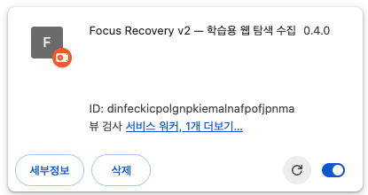

그림 1. **신규 캡처 / 기술 테스트.** 목적: 기존 확장 식별. 조작: 개발자 모드를 켜고 카드의 ID·세부정보·원형 새로고침 아이콘을 확인합니다. 정상: 동일 확장 카드가 유지됩니다. “삭제”는 업데이트 동작이 아닙니다.

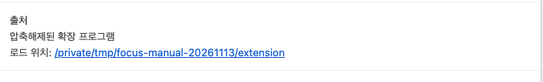

그림 2. **신규 캡처 / 기술 테스트, 세부정보 하단 확대.** 목적: 실제 로드 디렉터리 확인. 조작: 세부정보 하단 “로드 위치”를 확인합니다. 정상: 그림 1의 ID와 이 경로를 함께 기록할 수 있습니다. 사진의 `/private/tmp/.../extension`은 독립 검증 경로이며 팀원의 `fe/dist-real`을 뜻하지 않습니다.

## 5.2 같은 확장을 새로고침

정상 마감·pending 0·백업·빌드·DB 보존 확인 후, **기존 카드의 원형 새로고침**을 누릅니다. 새로고침 시 참여자 탭이 닫힐 수 있습니다. 같은 확장 화면을 다시 열고 같은 participant.json으로 재인증합니다. 업데이트 전후 ID와 Chrome 프로필이 같아야 합니다. 카드의 전체 “업데이트”나 새 확장 로드를 기존 카드 새로고침과 혼동하지 않습니다.

<!-- pagebreak -->

# 5장. 경로가 다른 기존 확장과 최초 설치

## 5.3 `fe/dist-real`에서 로드한 기존 확장

10쪽 `local.py build`는 같은 저장소의 `fe/dist-real`에 real 빌드를 만들고 배포 패키지를 생성합니다. 기존의 **절대 로드 경로**와 현재 저장소 경로가 일치하는지 확인한 뒤 기존 카드를 새로고침합니다. 저장소 폴더 이름을 바꾸거나 다른 clone으로 이동하면 경로가 달라집니다.

## 5.4 다른 폴더·과거 빌드에서 로드한 경우

`fe/dist`, `dist-participant`, `dist-pilot`, 다운로드/압축 해제 폴더, 다른 clone, 별도 검증 폴더는 `fe/dist-real`과 같은 저장소라고 가정할 수 없습니다. **이전 설치에서 현행 real 빌드로의 저장소 호환성은 이 매뉴얼에서 검증하지 않았습니다.**

1. 기존 확장 ID·Chrome 프로필·로드 절대 경로·빌드 정보를 기록하고 원본 폴더를 보존합니다.
2. 현재 세션·Queue·격리 상태를 확인하고 가능한 정상 마감/복구를 먼저 수행합니다. DB 백업만으로 미전송 IndexedDB가 보존되지는 않습니다.
3. 담당자와 이전 빌드의 IndexedDB 스키마·소유자·API/정책·업데이트 경로를 검토합니다. real 결과를 기존 폴더에 임의 복사하거나 새 경로를 별도 로드해 해결하지 않습니다.
4. **동일 경로·ID·프로필에서 데이터 보존 가능성이 확인된 경우만** 검토된 업데이트를 진행합니다. 확인 불가이면 원래 설치를 유지하고 수집을 중단합니다.

## 5.5 최초 설치에 한해 새로 로드

본인의 기존 확장·데이터·Credential·Volume이 모두 없음을 확인한 최초 설치만 개발자 모드 → **압축해제된 확장 프로그램 로드** → 본인 저장소의 `fe/dist-real` 선택 순서로 진행합니다. 최초 ID·절대 경로·Chrome 프로필을 기록합니다.

기존 설치가 유실되었거나 PC를 옮기는 상황은 단순 최초 설치가 아닙니다. 새 확장은 이전 Queue를 읽을 수 있다고 보장할 수 없습니다. 자동 제거·신규 설치 없이 담당자의 별도 복구 판단이 필요합니다.

## 5.6 업데이트 후 확인표

- 기존 확장 ID, 로드 절대 경로, Chrome 프로필이 유지됨
- 기존 Queue·Attempt 보존, 저장 오류 없음, 새 빌드 Commit 확인
- 서버 HTTPS 연결, 정책 6 / 공통 SHA / Plan revision 1 확인
- 본인 A54/B53/C53 배정, 직접 재동의, 서버 수집 Gate 확인

Chrome 프로필 경로는 `chrome://version`의 프로필 경로에서 비공개 확인할 수 있습니다. 개인 경로·프로필 전체 화면은 공유하지 않습니다. **해당 프로필 경로 화면은 이번 캡처에 포함하지 않았습니다.**

<!-- pagebreak -->

# 6장. HTTPS 인증서

## 6.1 본인의 localhost 인증서 확인

macOS:

```sh
keytool -printcert -file "$C_DIR/tls/localhost.cer"
python3 tools/individual-local/local.py --directory "$C_DIR" status
```

Windows PowerShell — 실제 장비 NOT_TESTED:

```powershell
keytool -printcert -file (Join-Path $LocalDir 'tls/localhost.cer')
python tools/individual-local/local.py --directory $LocalDir status
```

생성 주체·SHA-256 지문·localhost SAN·유효기간을 확인합니다. 모르는 인증서를 신뢰하지 않습니다. 생성된 인증서는 90일 유효하며 자동 갱신 기능은 없습니다.

## 6.2 OS 신뢰 설정 — 화면 미검증 / 예시 절차

**macOS:** 키체인 접근에서 본인의 localhost.cer를 로그인 키체인으로 가져옵니다. 인증서 세부정보의 지문·SAN·기간이 위 출력과 같은지 확인하고 SSL 신뢰를 설정합니다. 키체인 UI/실제 OS 신뢰 설치는 이번 검증 범위에 포함하지 않았습니다.

**Windows:** 확인한 본인 인증서만 현재 사용자 Root에 추가합니다.

```powershell
Import-Certificate -FilePath (Join-Path $LocalDir 'tls/localhost.cer') `
 -CertStoreLocation Cert:\CurrentUser\Root
```

## 6.3 Chrome 완전 재시작 후 연결 확인

정상 세션 종료·ACK를 확인한 뒤 Chrome의 모든 창과 프로세스를 종료하고 같은 프로필로 재실행합니다. 주소창에서 `https://localhost:9443/api/health`를 엽니다. 사용자 지정 포트는 config.json의 tlsPort를 사용합니다. **인증서 경고 없이 HTTP 200/정상 health 응답**이 보여야 합니다.

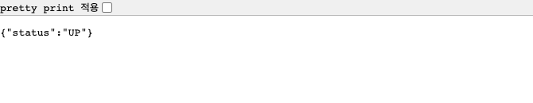

그림 3. **신규 캡처 / 기술 테스트.** 목적: 실제 Backend 응답 확인. 조작: 본인 health URL 접속. 정상: status UP 응답. 이 사진은 테스트 인증서의 SPKI를 고정한 자동화 브라우저이며 OS 신뢰 설치 성공의 증거가 아닙니다. 운영에서는 SPKI 예외·TLS 검증 해제·경고 우회를 사용하지 않습니다.

인증서 오류이면 호스트·포트·SAN·기간·키체인/Root·시스템 시각을 대조하고 중단합니다. 만료 시 담당자와 갱신·재신뢰를 진행합니다. 오류 해결을 위해 DB/Volume을 지우지 않습니다.

<!-- pagebreak -->

# 7장. Credential 로그인 및 직접 동의

## 7.1 참가자 화면에서 파일 선택

확장 아이콘으로 참여자 화면을 엽니다. 핀 고정이 안 되어 있으면 Chrome 확장 메뉴에서 Focus Recovery를 선택합니다. Chrome 내부·로그인·개인 문서 탭은 수집 대상이 아닙니다.

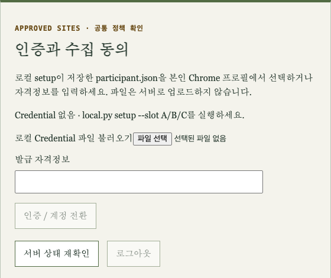

그림 4. **신규 캡처 / 기술 테스트.** 목적: Credential 파일 선택 위치 확인. 조작: “로컬 Credential 파일 불러오기”의 파일 선택에서 본인의 LocalDir/participant.json 선택. 정상: 로컬 슬롯과 서버 HTTPS 연결 정보가 표시됩니다. Credential 원문을 열거나 붙여넣지 않습니다.

## 7.2 로그인 후 반드시 확인

- 자기 슬롯 A/B/C, HTTPS 서버 포트, Plan revision 1
- 공통 SHA `31db27f0...7c2c982` 전체가 표지의 값과 일치
- 실제 배정 개수 A54/B53/C53, 정책 6
- 이전 소유자/슬롯 경고·빌드 정책 불일치·저장 오류가 없음

setup은 Credential을 로컬 파일로 저장하며 값은 출력하지 않습니다. 파일·Token·owner.key·개인키를 촬영하거나 공유하지 않습니다. 만료되어 재발급한 경우도 같은 Participant/LocalDir/Slot으로 재로그인합니다.

> 다른 사람의 Credential을 불러오거나 새 프로필로 옮겨 미전송 Queue를 해결하지 않습니다. 로그인 성공과 수집 동의 완료는 별도 단계입니다. 기존 v5 동의만으로 v6 수집을 시작할 수 없습니다.

<!-- pagebreak -->

# 7장. 정책 v6 읽기와 본인 직접 동의

## 7.3 목적·수집 항목·후속 이용 확인

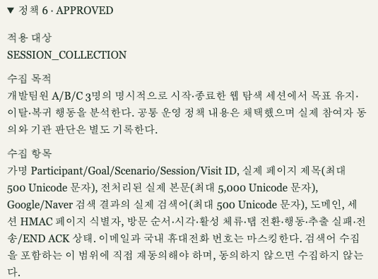

그림 5. **신규 캡처 / 기술 테스트, 실제 화면 부분 확대.** 목적: 정책 버전과 수집·이용 범위 확인. 조작: 정책 6의 제목/본문/허용 검색어, 행동, 보존·철회 항목을 읽습니다. 정상: v6 안내가 표시됩니다. 이전 “본문 미수집” 안내라면 업데이트를 다시 확인합니다.

수집 항목은 실제 제목·본문·허용 검색어와 행동입니다. 폼 입력값·로그인/결제·개인 문서·민감정보는 제외합니다. 원본은 공개/외부 재배포하지 않습니다. 이메일과 국내 휴대전화 마스킹은 개인정보 검수를 대신하지 않습니다.

v5에서 적법하게 수집한 정상 세션은 공식 v6 재동의 후 서버가 후속 이용을 허용한 경우에만 통합·검수에 포함됩니다. 과거 Consent ID는 그대로 보존합니다. 격리·철회·Tombstone을 setup이나 재동의로 해제하지 않습니다.

보존은 최종 평가 종료일+90일입니다. 실제 종료일·삭제 예정일·책임자·원본/백업/Export/파생물 사본을 운영 대장에 등록하고 삭제 실행·검증을 관리합니다.

<!-- pagebreak -->

# 7장. 동의 저장과 Gate 확인

## 7.4 본인이 체크하고 저장

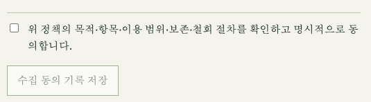

그림 6. **신규 캡처 / 기술 테스트, 실제 화면 부분 확대.** 목적: 직접 동의 조작 확인. 조작: 내용을 읽은 본인만 체크박스를 선택하고 “수집 동의 기록 저장”을 누릅니다. 정상: 서버 동의 유효 상태로 바뀝니다. 사진의 자동화 테스트 동의를 팀원 본인 동의로 사용할 수 없습니다.

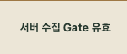

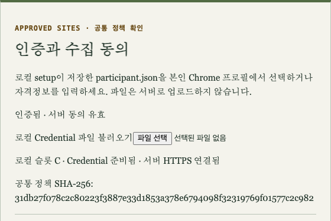

그림 7. **신규 캡처 / 기술 테스트.** 목적: 서버에서 확인한 동의·수집 Gate 점검. 조작: “서버 상태 재확인”으로 재조회. 정상: “서버 동의 유효”와 “서버 수집 Gate 유효”, 슬롯·SHA가 보입니다. 화면의 Gate만으로 세션 품질 완료를 판단하지 않습니다.

## 7.5 시작하면 안 되는 상태

동의 필요·withdrawn·정책/SHA 불일치·서버 연결 실패·잘못된 슬롯이면 세션 시작을 누르지 않습니다. 전체 동의 철회는 신규 수집을 막으며 기존 원본·Export·백업·파생물 회수 대상도 통합 담당자에게 전달해야 합니다.

<!-- pagebreak -->

# 8장. 실제 데이터 수집

## 8.1 본인 배정 선택과 ACTIVE 확인

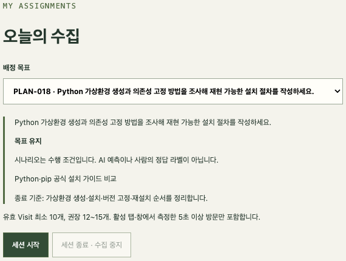

그림 8. **신규 캡처 / 기술 테스트.** 목적: 실제 배정·수행 조건 확인. 조작: “배정 목표”에서 본인의 미완료 Plan을 고르고 목표·시나리오·종료 기준을 읽은 뒤 “세션 시작”. 정상: 아래 상태가 ACTIVE로 바뀝니다. PLAN-018은 C 테스트 예시이며 모든 팀원에게 고정하지 않습니다.

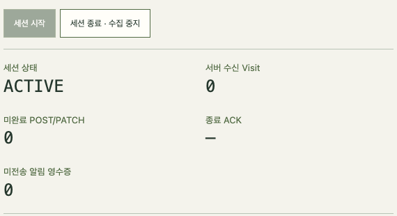

그림 9. **신규 캡처 / 기술 테스트.** 목적: 수집 시작 확인. 조작: ACTIVE와 초기 Visit·pending 확인 후 공개 페이지로 이동. 정상: 같은 배정의 새 Session/Attempt가 시작됩니다. 버튼 연타나 다른 배정 중복 시작은 하지 않습니다.

## 8.2 목표에 맞는 공개 웹페이지 탐색

본인이 접근·수집 권한을 확인한 공개 비민감 페이지를 읽습니다. 로그인·CAPTCHA·유료 제한·403/404를 우회하지 않습니다. 이번 화면 검증은 공개 Python 공식 문서에 실제 접속했지만 원본 수집 텍스트를 사진에 싣지 않았습니다. 모든 사이트가 포괄 허용된다는 뜻은 아닙니다.

<!-- pagebreak -->

# 8장. Visit을 충분히 모으기

## 8.3 활성 창·탭에서 각 5초 이상

페이지를 연 것만으로 Visit이 보장되지는 않습니다. 활성 창·탭에서 의미 있는 본문을 5초 이상 읽습니다. 추출·개인정보 검사에 통과한 SUCCESS Visit만 유효합니다. 일반 본문은 최소 50자, 검색 결과는 최소 1자 기준입니다.

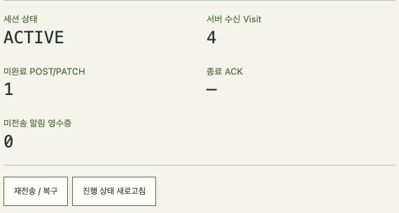

그림 10. **신규 캡처 / 기술 테스트.** 목적: 수신 수와 전송 상태 확인. 조작: 여러 공개 페이지를 읽고 참여자 화면에서 진행 상태 새로고침. 정상: ACTIVE 상태에서 서버 수신 Visit이 증가합니다. 사진의 4개는 부족 Visit 분기를 검증한 중간 상태이며 완료 기준이 아닙니다.

## 8.4 10개 이상, 권장 12~15개

- 같은 페이지의 제목 변경이나 추적 Query만 바꿔 건수를 채우지 않습니다.
- SPA·뒤로 가기·탭 전환도 기존 활성 세션으로 이어집니다. 복귀 경계는 4초 계약을 따릅니다. 유효한 실제 방문을 기준으로 확인합니다.
- 입력값·댓글·광고·메뉴·숨김 영역은 수집에서 제외됩니다. 늦게 로딩되는 본문은 다음 추출에서 반영될 수 있습니다.
- 제외된 Visit을 가짜 본문으로 채우지 않습니다. 실패 코드는 9장에 따라 기록하고 다음 공개 페이지에서 계속합니다.
- 민감정보를 일부러 입력하거나 민감 페이지를 찾아 격리를 시험하지 않습니다.

실제 수집 항목인 제목·본문·검색어는 캡처·채팅·공개 Issue에 넣지 않습니다. 운영 진단에는 상태 코드·시각·건수·식별자 접두부만 남깁니다.

<!-- pagebreak -->

# 8장. 종료·전송·RAW 완료 확인

## 8.5 종료 후 ACK를 기다리세요

“세션 종료 · 수집 중지” → ENDED → 종료 ACK `acked` → 미완료 POST/PATCH 0을 확인합니다. 이후 진행 상태 새로고침에서 전송 확인·유효 Visit≥10·원본 RAW_COLLECTED·AI NOT_RUN을 확인합니다.

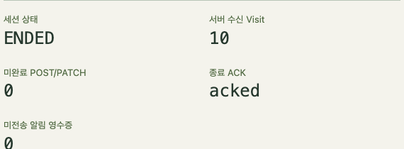

그림 11a. **신규 캡처 / 기술 테스트.** 목적: 안전한 마감. 조작: 세션 종료 후 기다림. 정상: ENDED·Visit 10·acked·미완료 0.

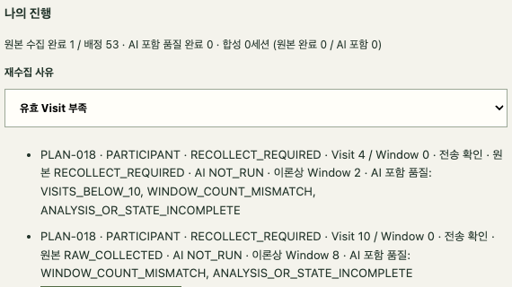

그림 11b. **신규 캡처 / 기술 테스트.** 목적: 원본 품질 확인. 조작: 진행 상태 새로고침. 정상: 최신 Visit 10 시도에 전송 확인·RAW_COLLECTED·NOT_RUN. 이전 4 Visit 시도도 보존되어 있습니다. 1/53은 전체 완료가 아닙니다.

## 8.6 DB와 화면 대조 후 첫 세션 PASS

7쪽에서 MySQL ID를 다시 조회하고 같은 SQL을 db-after-collection.txt라는 새 이름으로 실행합니다. 새 Session/Attempt·실제 Visit 저장 수·SUCCESS·5초 이상·양수/중복 없는 Sequence·전송 count/최종 Sequence를 대조합니다. Sequence에 빈 번호가 있다는 이유만으로 실패로 판단하지 않습니다.

최초 PASS는 Export/담당자 verify까지 확인한 범위에만 부여합니다. 10 Visit 미만은 ENDED/acked여도 재수집 대상입니다.

<!-- pagebreak -->

# 9장. 오류 및 재수집

## 9.1 제외와 격리를 구분하세요

|상황|사용자 조치|정상 확인 / 중단 조건|
|---|---|---|
|EXTRACTION_NO_CONTENT / DOM_ERROR / RENDER_TIMEOUT|다른 공개 페이지로 이동|다음 유효 Visit 증가 확인|
|ACCESS_DENIED / 구독·로그인 제한|접근 제한을 우회하지 않음|제외 코드만 기록, 원문 공유 금지|
|안전하게 마스킹할 수 없는 연락처|해당 Visit 제외 유지|개인정보 검사를 끄지 않음|
|SENSITIVE_CONTENT / 개인정보 격리|탐색 중단, 세션 종료·수집 중지|ENDED/QUARANTINED 및 격리 마감 접수|
|격리 마감 응답 유실|같은 프로필에서 본인 재인증, 재전송/복구|회수 접수·종료 ACK 확인|
|전송 실패 / END_PENDING|서버 연결·인증 확인, 재전송/복구|pending 0·acked·전송 확인까지 기다림|
|VISITS_BELOW_10|사유 기록 후 같은 Plan 재수집|새 Session/Attempt, 이전 시도 보존|
|전체 동의 철회|모든 신규 수집 중단|사본 회수·최신 privacy 전달|

격리는 Visit 0개여도 안전 마감이 필요합니다. 화면에서 “세션 종료 · 수집 중지”를 누르고 응답이 끊기면 같은 프로필의 “재전송 / 복구”를 사용합니다. **격리 마감 ACK와 회수 작업 완료는 다릅니다.** 마감 후에도 서버에서 회수 진행을 추적합니다.

## 9.2 언제 다음 배정을 시작하나요?

격리 마감·미처리 Queue를 확인한 후 본인의 다른 배정을 선택합니다. 같은 배정은 이전 Attempt에 사유를 기록해야 합니다. 기존 Queue·격리 이력·Tombstone을 지워서 시작 가능 상태로 만들지 않습니다.

저장 오류나 상태 불일치가 계속되면 시각·슬롯·Plan·오류 코드·ACK/pending·식별자 접두부만 담당자에게 전달합니다. Credential·원본 텍스트·민감 URL·setup/backend 로그 전체는 공유하지 않습니다.

> 이 장의 오류 대응표는 현행 코드/가이드 근거의 예시 절차입니다. 이번 화면 캡처를 위해 민감정보 입력·격리 유발·인증 만료·통신 단절을 실행하지 않았습니다. 해당 오류 화면은 화면 미검증입니다.

<!-- pagebreak -->

# 9장. 동일 배정 재수집

## 9.3 부족한 세션을 보존하고 새 시도 시작

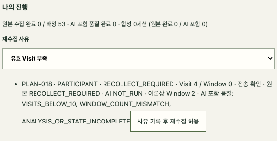

그림 12. **신규 캡처 / 기술 테스트.** 목적: 기존 시도를 유지한 재수집. 조작: “재수집 사유”에서 유효 Visit 부족 선택 → 이전 Attempt의 “사유 기록 후 재수집 허용”. 정상: 이전 시도가 RECOLLECT_REQUIRED로 남고 같은 Plan을 새로 시작할 수 있습니다.

종료된 4 Visit 세션에 6개를 추가하는 방식이 아닙니다. 같은 Plan으로 **새 Session/Attempt**를 만들고 새 세션에서 10개 이상 수집합니다. 재수집 후 완료 집계는 최신 시도를 따르며 과거 Attempt·Session·Visit는 보존됩니다. 기존 데이터를 삭제하거나 사유를 수동으로 바꾸지 않습니다.

## 9.4 통신·인증·정책 오류

- 전송 오류: HTTPS/서버 상태·인증을 확인하고 같은 프로필에서 재전송/복구합니다. 시작을 연타하거나 새 Source/키/프로필로 우회하지 않습니다.
- 인증 만료: 같은 Owner/LocalDir/Slot의 setup으로 재발급한 participant.json을 다시 불러옵니다. ACTIVE/과거 정책은 22쪽 동일 정책 복구를 검토합니다.
- 정책/SHA 불일치: config/site-policy, 서버 포트, 확장 로드 경로·build-info를 대조합니다. 백업 후 setup/build/기존 카드 새로고침을 수행합니다. SHA를 수동 수정해 통과시키지 않습니다.
- MYSQL_SHUTDOWN_UNCLEAN·exit137·OOM·Error: 정상 종료가 아닙니다. 원본·Volume·설정을 보존하고 담당자와 로그/전후 SQL을 검토합니다. 데이터 감소가 있으면 수집과 Export를 중단합니다.

<!-- pagebreak -->

# 9장. 안전한 재시작과 v5 예외 복구

## 9.5 동일 LocalDir에서 정상 재시작

수집 종료·ACK·백업을 먼저 확인합니다. 이미 장애가 났다면 새 탐색을 중단하고 Queue를 보존합니다. stop 실패 시 다음 명령을 실행하지 않습니다.

```sh
python3 tools/individual-local/local.py --directory "$C_DIR" stop
python3 tools/individual-local/local.py --directory "$C_DIR" db
python3 tools/individual-local/local.py --directory "$C_DIR" start
python3 tools/individual-local/local.py --directory "$C_DIR" status
```

Windows PowerShell — 실제 장비 NOT_TESTED:

```powershell
python tools/individual-local/local.py --directory $LocalDir stop
if ($LASTEXITCODE -ne 0) { throw '종료 이상. 중단' }
python tools/individual-local/local.py --directory $LocalDir db
if ($LASTEXITCODE -ne 0) { throw 'DB 시작 실패. 중단' }
python tools/individual-local/local.py --directory $LocalDir start
if ($LASTEXITCODE -ne 0) { throw 'Backend 시작 실패. 중단' }
python tools/individual-local/local.py --directory $LocalDir status
```

정상 stop은 MySQL 60초 유예와 exit=0/OOMKilled=false/Error 없음 확인을 포함합니다. start 직후 연결 대기이면 보호된 backend.log에서 시작 완료를 확인한 뒤 status를 재실행합니다. Volume은 유지됩니다.

## 9.6 v5의 0 Visit 격리 / ACTIVE_SESSION_POLICY_CHANGE

**화면 미검증 / 예외 절차.** 기존 v5 site-policy.json을 보존하고, 새 코드로 기존 정책을 명시해 마감만 수행합니다. 새 탐색은 하지 않습니다. 아래 설치 SHA가 없거나 파일과 다르면 중단합니다.

```sh
INSTALLED_SHA=$(python3 -c 'import json,sys; print(json.load(open(sys.argv[1]))["policySha256"])' "$C_DIR/config.json")
python3 tools/individual-local/local.py --directory "$C_DIR" setup \
 --slot "$SLOT" --policy "$C_DIR/site-policy.json" --policy-sha256 "$INSTALLED_SHA"
python3 tools/individual-local/local.py --directory "$C_DIR" build
```

```powershell
$InstalledSha = (Get-Content -Raw (Join-Path $LocalDir 'config.json') | ConvertFrom-Json).policySha256
python tools/individual-local/local.py --directory $LocalDir setup `
 --slot $Slot --policy (Join-Path $LocalDir 'site-policy.json') --policy-sha256 $InstalledSha
python tools/individual-local/local.py --directory $LocalDir build
```

같은 확장 새로고침 → 본인 인증 → 격리 마감 확인 → 정책 인자 없는 10쪽 setup/build로 v6 업데이트 → 직접 재동의 순서입니다. 이미 서버 QUARANTINED인 세션은 v6에서 본인 인증 후 마감할 수 있습니다. 담당자와 [상세 복구 가이드](https://github.com/SKHU-AI-Projects-Archive/2026-2-Capstone-T01-focus-recovery/blob/main/docs/data-collection/page-content-collection.md)를 함께 확인합니다.

<!-- pagebreak -->

# 10장. 데이터 Export 및 제출

## 10.1 macOS — 암호화해서 전달

본인 동의가 유효한 ENDED 데이터를 대상으로 진행합니다. 통합 담당자의 **age1 공개 수신키만** 별도 인증 경로로 확인해 받습니다. 본인 백업 개인키를 제출하지 않습니다. 6쪽의 이번 Run 경로를 사용하고 기존 출력 파일은 덮어쓰지 않습니다.

```sh
read -r AGE_RECIPIENT
TLS_PORT=$(python3 -c 'import json,sys; print(json.load(open(sys.argv[1]))["tlsPort"])' "$C_DIR/config.json")
SERVER="https://localhost:$TLS_PORT"
python3 tools/individual-local/dataset.py export \
 --server "$SERVER" --ca-file "$C_DIR/tls/localhost.pem" \
 --credential-file "$C_DIR/participant.json" \
 --recipient "$AGE_RECIPIENT" --output "$RUN/$SLOT-001.tar.age"
shasum -a 256 "$RUN/$SLOT-001.tar.age"
python3 tools/individual-local/dataset.py privacy \
 --server "$SERVER" --ca-file "$C_DIR/tls/localhost.pem" \
 --credential-file "$C_DIR/participant.json" \
 --output "$RUN/$SLOT-privacy-001.json"
```

`read` 다음 줄에는 확인한 수신키를 입력합니다. Export는 즉시 age 암호화합니다. 별도 평문 Export·수동 재암호화는 필요 없습니다. Export 출력 SHA와 shasum 계산값을 대조합니다.

## 10.2 최신 Privacy Snapshot

privacy 출력의 `sha256`, `observedAt`를 기록합니다. observedAt은 Export 이후이며 Import 현재 시각부터 **15분 이내**여야 합니다. 전달이 지연되면 기존 파일은 보존하고 `privacy-002.json`처럼 새 이름으로 다시 조회합니다. 15분은 freshness 한도이며 보존기간이 아닙니다.

암호문·최신 privacy 두 파일과 각 출력 SHA를 승인된 비공개 경로로 전달합니다. SHA는 별도 인증 경로로도 대조합니다. Slot·Commit·Source/Participant·Export ID·Plan·시각·배포처·본 수집/기술 테스트 구분을 비공개 사본 대장에 기록합니다. privacy도 ID·동의·격리 메타데이터이므로 공개하지 않습니다.

> Export 파일과 privacy·키·Registry·DB·Chrome 프로필·원본 텍스트·로그는 Git 업로드 금지입니다. `.collection`이 ignore 대상이어도 클라우드 동기화나 타 사용자 접근을 자동 차단하지 않습니다.

<!-- pagebreak -->

# 10장. Windows Export 및 제출

## 10.3 PowerShell — 실제 장비 NOT_TESTED

6쪽의 Slot/LocalDir/RunDir 변수를 같은 터미널에서 사용합니다. 각 명령의 exit 0을 바로 확인한 뒤 다음 줄로 진행합니다.

```powershell
$AgeRecipient = Read-Host '확인한 통합 담당자의 age1 공개키'
$TlsPort = (Get-Content -Raw (Join-Path $LocalDir 'config.json') | ConvertFrom-Json).tlsPort
$Server = "https://localhost:$TlsPort"
python tools/individual-local/dataset.py export `
 --server $Server --ca-file (Join-Path $LocalDir 'tls/localhost.pem') `
 --credential-file (Join-Path $LocalDir 'participant.json') `
 --recipient $AgeRecipient --output (Join-Path $RunDir "$Slot-001.tar.age")
if ($LASTEXITCODE -ne 0) { throw 'Export 실패. 중단' }
(Get-FileHash (Join-Path $RunDir "$Slot-001.tar.age") -Algorithm SHA256).Hash.ToLowerInvariant()
python tools/individual-local/dataset.py privacy `
 --server $Server --ca-file (Join-Path $LocalDir 'tls/localhost.pem') `
 --credential-file (Join-Path $LocalDir 'participant.json') `
 --output (Join-Path $RunDir "$Slot-privacy-001.json")
if ($LASTEXITCODE -ne 0) { throw 'privacy 조회 실패. 중단' }
```

백틱 뒤에 공백을 붙이지 않습니다. privacy freshness·SHA 별도 대조·비공개 전송 원칙은 macOS와 같습니다. 실제 Windows 인증서/ACL/셸 실행을 확인하기 전 Windows 완료로 표시하지 않습니다.

## 10.4 팀원이 제출할 항목

- 암호화 `.tar.age`, 별도 인증해 확인한 암호문 SHA-256
- Export 이후 15분 이내 최신 privacy JSON과 해당 SHA-256
- 본인 슬롯·코드 Commit·정책 v6/SHA·Plan revision
- 본인 직접 동의·유효 Visit·ACK/pending·RAW/AI·기존 데이터 보존 결과
- 미해결 오류·사본 보관/회수 담당자·기술 테스트와 본 수집 구분

백업 키·통합 개인키·Credential·Token·owner.key는 제출하지 않습니다. 제출 경로가 없거나 담당자가 최신 철회 상태/사본 회수를 관리할 수 없다면 실제 데이터 이용을 진행하지 않습니다.

<!-- pagebreak -->

# 10장. 통합 담당자 — 수신·verify

## 10.5 키와 수신 폴더 준비

아래 키 생성은 통합 담당자가 **처음 한 번만**, 아직 존재하지 않는 경로에 실행합니다. 기존 키를 덮어쓰지 않습니다. 실데이터는 승인된 보호 디스크를 사용합니다. 예시 `.collection/merge`는 Git 제외 경로입니다.

```sh
umask 077
mkdir -p .collection/merge/incoming
age-keygen -o .collection/merge/identity.agekey
age-keygen -y .collection/merge/identity.agekey
```

Windows PowerShell — 실제 장비 NOT_TESTED:

```powershell
New-Item -ItemType Directory -Path .collection/merge/incoming
icacls .collection/merge /inheritance:r /grant:r "$($env:USERNAME):(OI)(CI)F"
age-keygen -o .collection/merge/identity.agekey
age-keygen -y .collection/merge/identity.agekey
```

공개 수신키만 팀원에게 전달합니다. 각 팀원의 파일을 `incoming/A-001.tar.age` 등으로 받되 원본을 보존하고 사본 대장에 기록합니다. 발신자가 확인한 SHA를 별도 인증 경로로 받습니다.

## 10.6 수신본 검증 — A 예시, B/C도 반복

macOS:

```sh
read -r A_SHA256
python3 tools/individual-local/dataset.py verify \
 .collection/merge/incoming/A-001.tar.age \
 --identity .collection/merge/identity.agekey --sha256 "$A_SHA256"
python3 tools/individual-local/dataset.py inspect \
 .collection/merge/incoming/A-001.tar.age \
 --identity .collection/merge/identity.agekey
```

Windows는 `python`과 `$aHash = Read-Host 'A의 확인된 SHA-256'`를 사용하고 `--sha256 $aHash`로 실행합니다. B/C도 각 파일과 확인한 해시로 반복합니다. Manifest/SHA·출처·참조·privacy가 실패하면 원본·Registry를 보존하고 중단합니다. 메모리에서 복호화하며 평문을 공유 디스크에 풀지 않습니다. 전체 해독 크기 상한은 256MiB이며 검증을 끄지 않습니다.

<!-- pagebreak -->

# 10장. Import·merge — macOS

## 10.7 확인한 SHA와 최신 privacy로 통합

`dataset.py`에 별도 import 명령은 없습니다. **merge가 Import를 수행**하고 검증된 JSONL 데이터셋을 만듭니다. raw MySQL 테이블에 쓰지 않습니다. 25쪽 verify/inspect를 먼저 마친 A/B/C 파일을 사용합니다. 각 `read` 뒤에 별도 경로로 확인한 해당 값을 입력합니다.

```sh
read -r A_SHA256
read -r B_SHA256
read -r C_SHA256
read -r A_PRIVACY_SHA256
read -r B_PRIVACY_SHA256
read -r C_PRIVACY_SHA256
AGE_RECIPIENT=$(age-keygen -y .collection/merge/identity.agekey)
python3 tools/individual-local/dataset.py merge \
 .collection/merge/incoming/A-001.tar.age \
 .collection/merge/incoming/B-001.tar.age \
 .collection/merge/incoming/C-001.tar.age \
 --bundle-sha256 "$A_SHA256" --bundle-sha256 "$B_SHA256" \
 --bundle-sha256 "$C_SHA256" \
 --privacy .collection/merge/incoming/A-privacy-001.json "$A_PRIVACY_SHA256" \
 --privacy .collection/merge/incoming/B-privacy-001.json "$B_PRIVACY_SHA256" \
 --privacy .collection/merge/incoming/C-privacy-001.json "$C_PRIVACY_SHA256" \
 --identity .collection/merge/identity.agekey --recipient "$AGE_RECIPIENT" \
 --registry .collection/merge/registry.sqlite \
 --output .collection/merge/dataset-001.tar.age
python3 tools/individual-local/dataset.py verify \
 .collection/merge/dataset-001.tar.age --identity .collection/merge/identity.agekey
python3 tools/individual-local/dataset.py inspect \
 .collection/merge/dataset-001.tar.age --identity .collection/merge/identity.agekey
```

암호문 SHA 순서는 입력 파일 A/B/C 순서와 같아야 합니다. privacy가 오래되면 각 Source에서 새 이름으로 다시 발급받고 경로와 확인한 SHA를 함께 바꿉니다. 실데이터에 synthetic 예외 옵션을 쓰지 않습니다.

부분 통합은 필요한 Source의 Export/privacy 쌍만 지정합니다. 동일 Registry를 유지하며 다음 통합에 계속 포함할 원본 Export도 다시 입력합니다. Registry가 과거 데이터를 자동 첨부하지 않습니다. 중복 Import 점검은 같은 Registry와 **새 출력 이름**으로 수행하며 Registry를 초기화하지 않습니다.

<!-- pagebreak -->

# 10장. Import·merge — Windows

## 10.8 PowerShell 예시 — 실제 장비 NOT_TESTED

A/B/C verify/inspect 후 실행합니다. 새 출력 이름을 사용합니다.

```powershell
$aHash = Read-Host 'A 암호문의 확인된 SHA-256'
$bHash = Read-Host 'B 암호문의 확인된 SHA-256'
$cHash = Read-Host 'C 암호문의 확인된 SHA-256'
$aPrivacyHash = Read-Host 'A 최신 privacy의 확인된 SHA-256'
$bPrivacyHash = Read-Host 'B 최신 privacy의 확인된 SHA-256'
$cPrivacyHash = Read-Host 'C 최신 privacy의 확인된 SHA-256'
$mergeRecipient = age-keygen -y .collection/merge/identity.agekey
python tools/individual-local/dataset.py merge `
 .collection/merge/incoming/A-001.tar.age `
 .collection/merge/incoming/B-001.tar.age `
 .collection/merge/incoming/C-001.tar.age `
 --bundle-sha256 $aHash --bundle-sha256 $bHash --bundle-sha256 $cHash `
 --privacy .collection/merge/incoming/A-privacy-001.json $aPrivacyHash `
 --privacy .collection/merge/incoming/B-privacy-001.json $bPrivacyHash `
 --privacy .collection/merge/incoming/C-privacy-001.json $cPrivacyHash `
 --identity .collection/merge/identity.agekey --recipient $mergeRecipient `
 --registry .collection/merge/registry.sqlite `
 --output .collection/merge/dataset-001.tar.age
if ($LASTEXITCODE -ne 0) { throw 'Import 실패. 원본/Registry 보존' }
python tools/individual-local/dataset.py verify `
 .collection/merge/dataset-001.tar.age --identity .collection/merge/identity.agekey
python tools/individual-local/dataset.py inspect `
 .collection/merge/dataset-001.tar.age --identity .collection/merge/identity.agekey
```

## 10.9 통합 결과 해석

Source/Participant/Slot·공통 Plan/checksum·Session–Attempt–Visit–Consent 참조·Sequence·최신 Attempt·전송/품질·철회/격리/Tombstone을 검증합니다. 공식 v5 정상 데이터는 현재 v6 동의의 후속 이용 권한도 확인합니다.

3인 첫 1세션씩만 통합하면 160개 전체 기준은 **PARTIAL**입니다. RAW COMPLETE도 사람의 개인정보/이용 권한 검수·정답 라벨링·학습 완료를 뜻하지 않습니다. training-review 후속 절차는 [원본 수집 가이드](https://github.com/SKHU-AI-Projects-Archive/2026-2-Capstone-T01-focus-recovery/blob/main/docs/data-collection/page-content-collection.md)를 따릅니다.

<!-- pagebreak -->

# 10장. 팀원별 완료 결과표

## 10.10 실제로 수행한 범위만 기록

아래는 이번 문서 제작으로 팀원 장비를 검증했다는 뜻이 아닙니다. 각자 비공개 운영 기록에 결과를 남기고 담당자가 확인합니다. **Closed Issue #112를 다시 열거나 수정하지 않습니다.** 기존 현장 가이드의 Issue 제출 문구는 당시 기록이며 이번 후속 안내의 제출 지시가 아닙니다.

|확인 항목|A (54)|B (53)|C (53)|
|---|---|---|---|
|본인 OS·버전·Commit|NOT_TESTED|NOT_TESTED|NOT_TESTED|
|정책 v6·공식 SHA|NOT_TESTED|NOT_TESTED|NOT_TESTED|
|기존 DB 백업·SHA·복호화|NOT_TESTED|NOT_TESTED|NOT_TESTED|
|전후 데이터·ID 보존|NOT_TESTED|NOT_TESTED|NOT_TESTED|
|확장 ID·로드 경로·프로필 유지|NOT_TESTED|NOT_TESTED|NOT_TESTED|
|인증서 신뢰·HTTPS|NOT_TESTED|NOT_TESTED|NOT_TESTED|
|본인 직접 동의·Gate|NOT_TESTED|NOT_TESTED|NOT_TESTED|
|실제 Plan·Session/Attempt 접두부|NOT_TESTED|NOT_TESTED|NOT_TESTED|
|유효 Visit≥10·DB 저장|NOT_TESTED|NOT_TESTED|NOT_TESTED|
|ENDED / acked / pending 0|NOT_TESTED|NOT_TESTED|NOT_TESTED|
|RAW_COLLECTED / NOT_RUN|NOT_TESTED|NOT_TESTED|NOT_TESTED|
|Export·SHA·최신 privacy|NOT_TESTED|NOT_TESTED|NOT_TESTED|
|담당자 verify / Import|NOT_TESTED|NOT_TESTED|NOT_TESTED|
|미해결 문제·최종 판정|NOT_TESTED|NOT_TESTED|NOT_TESTED|

PASS/FAIL/NOT_TESTED와 수행 시각·담당자·검증 범위를 기록합니다. 최초 설치는 기존 백업을 “해당 없음: 최초 설치, 기존 DB 없음”으로 기재합니다. 미수행 장애 분기는 NOT_TESTED로 남깁니다. 전체 수집은 첫 세션 Export/담당자 verify 및 보존 검증 후 진행합니다.

## 10.11 제출 후에도 남는 책임

최종 평가 종료+90일 정책의 실제 삭제일·책임자·모든 사본 위치를 관리합니다. 철회가 발생하면 즉시 이용 중단/격리하고 Export·백업·통합본·파생 검수 데이터까지 회수합니다. 과거 파일이 자동 삭제되지는 않습니다. 최신 privacy와 사본 대장·Registry·철회 원장을 접근 통제하고 개인키는 별도 보관합니다.

<!-- pagebreak -->

# 부록 A. 근거와 화면 출처

## A.1 현행 근거 문서

- [공식 Repository](https://github.com/SKHU-AI-Projects-Archive/2026-2-Capstone-T01-focus-recovery)
- [현장 검증 순서표](https://github.com/SKHU-AI-Projects-Archive/2026-2-Capstone-T01-focus-recovery/blob/main/docs/data-collection/team-field-validation.md)
- [개인 로컬 설치](https://github.com/SKHU-AI-Projects-Archive/2026-2-Capstone-T01-focus-recovery/blob/main/docs/data-collection/individual-local-setup.md)
- [페이지 원본 수집·예외 복구](https://github.com/SKHU-AI-Projects-Archive/2026-2-Capstone-T01-focus-recovery/blob/main/docs/data-collection/page-content-collection.md)
- [Export/Import 통합](https://github.com/SKHU-AI-Projects-Archive/2026-2-Capstone-T01-focus-recovery/blob/main/docs/data-collection/merge-guide.md)
- [TEAM_POLICY.json](https://github.com/SKHU-AI-Projects-Archive/2026-2-Capstone-T01-focus-recovery/blob/main/docs/data-collection/TEAM_POLICY.json) / [SHA 파일](https://github.com/SKHU-AI-Projects-Archive/2026-2-Capstone-T01-focus-recovery/blob/main/docs/data-collection/TEAM_POLICY.sha256)
- [PR #113](https://github.com/SKHU-AI-Projects-Archive/2026-2-Capstone-T01-focus-recovery/pull/113) / [PR #114](https://github.com/SKHU-AI-Projects-Archive/2026-2-Capstone-T01-focus-recovery/pull/114) / [Issue #112 · Closed](https://github.com/SKHU-AI-Projects-Archive/2026-2-Capstone-T01-focus-recovery/issues/112)
- [기준 Commit](https://github.com/SKHU-AI-Projects-Archive/2026-2-Capstone-T01-focus-recovery/commit/b7875b12884317346c650d5bd1a4a309fb0d0550)

## A.2 이번 실제 캡처의 범위

2026-11-13 KST, macOS의 신규 독립 C Source·전용 MySQL/HTTPS 19873·신규 테스트 Chrome 프로필에서 현행 main의 Backend와 real Extension을 빌드/실행했습니다. 기존 참여자 환경은 사용하지 않았습니다. 캡처는 원본 화면을 확대하기 위한 직사각형 crop만 수행했고 UI 문구·상태를 합성하지 않았습니다. Chrome for Testing 151.0.7922.34를 사용했습니다.

그림 1~12(11a/11b 포함, 총 14개 이미지)는 모두 **신규 캡처**입니다. 확장 관리/세부정보·로그인 전·동의 정책/조작·동의 상태·실제 배정·ACTIVE·4 Visit 진행·10 Visit ENDED/RAW_COLLECTED·재수집·health를 포함합니다. 같은 화면의 부분 확대는 같은 시점의 캡처입니다. 과거 검증 이미지 재사용은 **0장**입니다.

실제 공개 Python 문서를 4 Visit 후 같은 Plan으로 10 Visit 재수집했습니다. 최초 Attempt와 14개 전체 Visit를 보존했습니다. 기술 테스트 자동 동의·연구 실적 0건입니다. 테스트 인증서 SPKI 고정만 사용했으며 OS 신뢰 설치는 검증하지 않았습니다.

## A.3 캡처하지 않은 화면

실제 팀원 A/B/C 개인 장비, Windows, 키체인/현재 사용자 Root 신뢰 UI, 실제 개인 프로필 경로, 과거 빌드→real 저장소 마이그레이션은 접근/호환 검증 범위 밖입니다. 격리·인증 만료·통신 단절은 의도적으로 유발하지 않아 신규 장애 화면이 없습니다. 공개 페이지 원문·DB 원본·Credential/Token/개인키는 배포 이미지에서 제외했습니다. 예시 절차/화면 미검증 표시를 따릅니다.

<!-- pagebreak -->

# 부록 B. 검증 기록과 배포 전 확인

## B.1 문서 제작 검증

기준 Commit은 표지의 main SHA입니다. Markdown/PDF 명령은 local.py와 dataset.py의 현행 argparse 및 빌드 구현과 대조합니다. CLI 옵션 파싱 40개(macOS 21·PowerShell 19), bash 구문 18블록, 외부 링크 20개 HTTP 200, 실제 정책 검증 PASS를 확인했습니다. 옵션 파싱은 명령 전체의 운영 실행이나 Windows 셸 검증을 뜻하지 않습니다.

독립 테스트 C에서 실제 Chrome 새로고침 버튼을 눌러 같은 ID·경로·프로필, 2개 Attempt·14 Visit, ENDED/acked/pending 0 보존을 확인했습니다. 새로고침 후 같은 Credential 재인증이 필요했습니다. 현행 real 빌드의 새로고침 검증이며 과거 다른 빌드의 마이그레이션 검증은 아닙니다. 암호화 backup·SHA 일치·복호화 출력 폐기·현장 SQL도 테스트 DB에서 PASS했습니다. 운영 복원은 미실시입니다.

PDF는 A4 세로·한국어 글꼴 포함·페이지 번호와 링크를 사용합니다. 전체 페이지를 PNG로 렌더링하여 페이지별 한글·코드·표·이미지·하단 여백을 확인합니다. 상세 검증 결과와 이미지 출처/해시는 [검증 기록](team-data-collection-manual-validation.json)에 기록합니다.

## B.2 팀원이 최종 확인할 체크리스트

- 최신 공식 main과 이 문서 기준 Commit/정책 SHA 비교
- 기존 확장 삭제 금지, 동일 ID·절대 경로·Chrome 프로필 유지
- 현재 Session/Queue/격리 확인, 암호화 백업·SHA·복호화 확인
- 업데이트 전후 Session/Visit/Attempt/Consent·Source·Participant 보존
- 본인 OS 인증서 신뢰, 경고 없는 HTTPS, 본인 Credential·정책 6
- 수집 항목을 읽은 본인 직접 동의, 서버 동의/Gate 유효
- 본인 배정 첫 1세션 10 Visit·ENDED·acked·pending 0·RAW/AI·DB
- 암호화 Export/확인된 SHA·최신 privacy·담당자 verify/Import
- 원본/키/Token/개인정보 Git 업로드 없음, 사본 회수·삭제 책임 지정

## B.3 해석의 한계

이 매뉴얼 제작의 자동화 테스트는 실제 팀원의 직접 동의·운영 데이터 복원·개인 장비 검증을 대신하지 않습니다. Windows와 다른 과거 확장 빌드의 저장소 호환성은 NOT_TESTED입니다. 확인되지 않은 기존 설치를 제거하거나 새 확장으로 바꾸지 않습니다.

새 기능·DB 스키마·기존 현장 검증 문서는 변경하지 않습니다. 완료된 Issue #112는 읽기 전용으로만 참조합니다. 문서 변경은 별도 브랜치와 후속 PR로 검토합니다.
