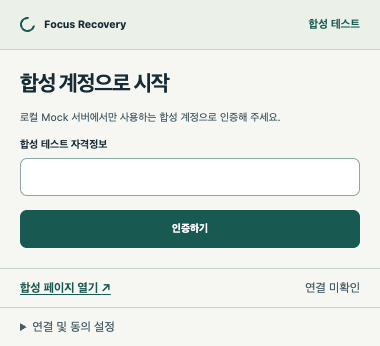
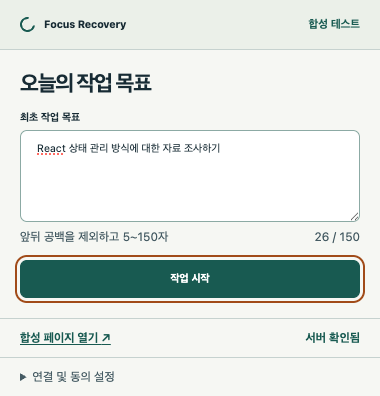
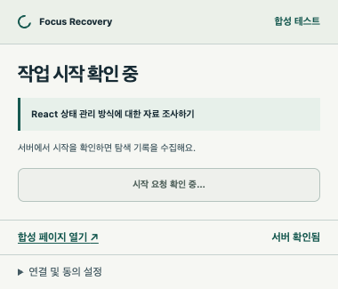
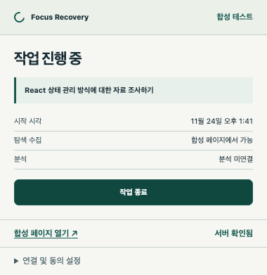
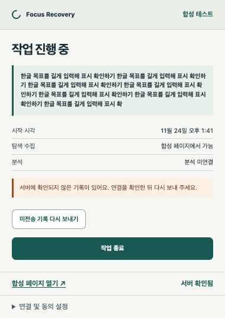
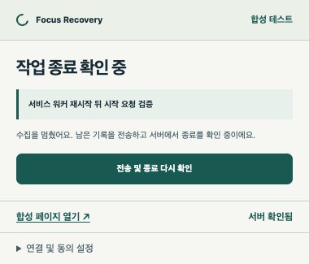
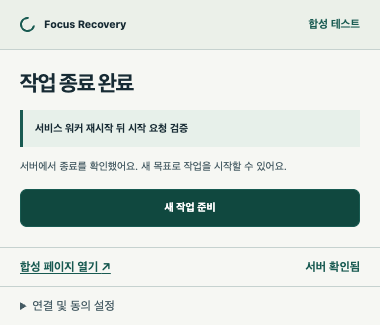

# Issue #133 사용자용 v2 Chrome Extension

2026-11-24 KST · [Issue #133](https://github.com/SKHU-AI-Projects-Archive/2026-2-Capstone-T01-focus-recovery/issues/133) · 기준 `upstream/main` `7c6a9bdf35580291770a75db97383a15354b5743` ([PR #132](https://github.com/SKHU-AI-Projects-Archive/2026-2-Capstone-T01-focus-recovery/pull/132) 병합) · 브랜치 `feat/133/user-v2-extension`

사용자가 최초 목표를 입력해 합성 v2 작업을 시작하고, 허용된 페이지를 탐색한 뒤 전송과 종료 확인까지 마칠 수 있다. Chrome은 별도 사용자용 Manifest와 Worker를 로드한다. 기존 수집용 실행 경로, 서버 Gate 및 P1~P6 정책은 기존 설정을 사용한다.

## 빌드, 설치 및 실행

저장소의 `fe`에서 Node.js 22.12 이상으로 실행한다.

```sh
cd fe
npm ci
npm run build:user
npm run mock:user
```

1. 별도 Chrome 테스트 프로필의 `chrome://extensions`에서 개발자 모드를 켜고 **압축해제된 확장 프로그램을 로드합니다**를 눌러 `fe/dist-user`를 선택한다.
2. 툴바에서 **Focus Recovery · 사용자 합성 테스트**를 열고 합성 계정 `synthetic-user-133-alice-for-local-tests-0123456789`으로 인증한다. 이 값은 Mock 서버의 고정 공개 테스트 입력이다.
3. 합성 동의를 저장한 뒤 최초 목표를 입력하고 **작업 시작**을 누른다. 시작 응답을 확인하면 **작업 진행 중**으로 바뀐다.
4. 팝업의 **합성 페이지 열기**에서 [첫 합성 페이지](http://127.0.0.1:8911/__focus_synthetic__/a)를 연다. 각 합성 문서를 활성 Chrome 창의 활성 탭에서 5초 이상 읽고 아래 링크를 통해 다음 문서로 이동한다.
5. 팝업을 다시 열어 **작업 종료**를 누른다. **작업 종료 완료**를 확인한 뒤 **새 작업 준비**에서 다음 목표를 입력할 수 있다.
6. 연결을 끊었다가 복구하면 **같은 시작 요청 다시 확인**, **기존 작업 재연결**, **미전송 기록 다시 보내기**, **전송 및 종료 다시 확인** 중 현재 화면이 제공하는 동작을 실행한다. Chrome을 다시 시작한 경우 같은 합성 계정으로 인증한다.

Mock 서버는 API `127.0.0.1:8912`, 합성 문서 `127.0.0.1:8911`에 바인딩한다. 포트가 사용 중이면 실행이 실패한다. Mock 서버는 처리한 세션과 동의를 메모리에 보존하므로 Worker 또는 Chrome 재시작을 시연할 때 서버는 켜 둔다. Mock 서버를 종료하면 서버 데이터도 사라진다. 새 시연을 함께 시작할 때는 새 합성 Chrome 프로필을 사용한다.

## 구조와 메시지 계약

| 위치 | 책임 |
| --- | --- |
| `fe/user/index.html`, `index.tsx`, `style.css` | 독립 React/TypeScript 팝업, 목표 입력·상태 조회·명령, 접근성 |
| `fe/user/background.ts`, `protocol.ts` | 신뢰 발신자 및 명령 검사, 사용자용 Worker 진입, 민감 필드를 제외한 스냅샷 |
| `fe/user/transport.ts`, `mock-config.ts` | 고정 Mock origin, 합성 정책 검사, 기존 인증 fetch 및 `V2Transport` 주입 |
| `fe/vite.user.config.ts` | 별도 Manifest V3, 팝업, Worker, CSP 및 `dist-user` |
| `fe/scripts/user-mock.mjs`, `user-browser-test.mjs` | 실제 Mock HTTP, 합성 카탈로그 서버, 응답 유실 및 재시작 검증 |

Worker가 저장과 라이프사이클을 소유한다. 팝업은 `status`로 Worker가 검증한 스냅샷을 읽고 화면을 렌더링한다. 목표 입력값과 요청 중 여부는 팝업의 로컬 상태다. 팝업의 연결 표시와 액션은 스냅샷 도착 순서와 진행 중 요청을 확인한다. Chrome 최소 버전은 기존 수집 빌드와 같은 106이다.

| 메시지 | 입력과 처리 |
| --- | --- |
| `status` / `access` | 로컬 검증 상태 조회 / 서버 인증·동의 확인과 활성 세션 재연결 |
| `login` / `agree` | 합성 자격정보 / 서버가 내려준 합성 정책의 동의 |
| `start` / `retry-start` | 새 목표 문자열 / 저장된 목표와 같은 시작 키 |
| `reconnect` / `retry` | 동일 자유 목표 세션 조회 / 미확인 전송·종료·철회 재시도 |
| `stop` | 화면에 표시한 세션 시작 시각과 Worker의 현재 시작 시각 대조 후 종료 의도 접수 |
| `logout` / `withdraw` | 신뢰 컨텍스트 자격정보 해제 / 기존 철회·격리 전송기 호출 |

`installV2Browser`는 사용자용 실행 정책에 공통 Chrome 이벤트, 합성 Content Script, `V2Collector`를 연결한다. 기존 participant의 배정·Attempt·품질·알림 명령은 사용자용 채널에서 호출할 수 없다. DB 이름을 선택하는 기존 `V2Repository`가 `focus-recovery-user-v2-mock`을 열고 수집용 호출에는 기존 기본값을 적용한다. 같은 포맷과 CAS 커밋, Visit POST, Behavior PATCH, 멱등 키, ACK 검증, 개인정보 격리 및 전송기를 공유한다. 체류시간 5초, 4초 복귀, 5분 행동 갱신 규칙은 기존 수집기가 처리한다.

사용자용 스냅샷은 인증·권한·서버 확인·수집·저장 오류와 현재 상태를 전달한다. Worker는 검증된 소유자에 한해 목표와 시작 시각을 전달한다. 합성 카탈로그의 본문, Credential, 세션 ID, 내부 키와 ACK는 Worker에 남는다. Content Script는 지정한 최상위 현재 문서에서 합성 카탈로그의 식별자만 보내고 Worker는 사전 정의된 제목·본문을 매핑한다.

## 상태 전환

| 상태 | 전환 조건 및 복구 |
| --- | --- |
| `IDLE` | 인증·합성 동의·사이트 권한 확인 후 목표 입력. Java `strip()` 상당의 앞뒤 공백 정리와 UTF-16 5~150자 검사를 공유한다. |
| `START_PENDING` | HTTP 전에 목표·소유자·동의·키를 커밋한다. 요청 유실, v1 또는 목표 불일치 시 같은 키와 목표를 유지한다. 이전 세션 ID를 함께 보존해 재시도에서 이전 세션 응답을 거절한다. |
| `ACTIVE` | 유효한 v2 ACTIVE 응답을 확인한 뒤에만 수집을 허용한다. Worker 재기동, 권한 단계 전환 및 재인증 후 저장된 세션 ID·목표·시작 시각과 서버 상태가 일치해야 수집과 전송을 재개한다. |
| `END_PENDING` | 종료 의도 접수 즉시 관측이 멈춘다. 기존 POST/PATCH ACK가 커밋된 후 종료 요청을 처리한다. 응답을 잃으면 같은 세션을 조회하고, 서버가 아직 ACTIVE면 같은 종료 본문을 다시 보낸다. 서버가 먼저 종료했어도 미확인 전송을 ACK로 간주하지 않는다. |
| `ENDED` | 기존 전송기의 종료 ACK 검증 및 영속 커밋 후에 표시한다. 다음 작업을 시작할 때 이전 완료 세션은 같은 DB의 보관 레코드로 이동한다. |

## 격리 및 권한

- Manifest 권한은 `storage`, `alarms`, `webNavigation`이다. 호스트 권한은 HTTP `127.0.0.1` 하나로 제한한다. Chrome match pattern의 포트 제약을 보완하기 위해 Content Script의 Worker 검증은 8911 포트의 카탈로그 a~d와 일치하는 URL만 허용한다. CSP와 API 클라이언트는 8912 포트만 연결한다. 환경 변수가 다른 origin을 지정하면 빌드를 차단한다.
- Worker는 같은 Extension ID, 등록 팝업 URL, 주 프레임·활성 문서와 메시지 입력을 확인한다. 웹페이지와 Content Script의 세션 제어 명령은 거절한다. Credential은 기존 `auth-fetch`를 통해 `TRUSTED_CONTEXTS`의 `chrome.storage.session`에만 남는다.
- 압축해제된 확장의 식별자는 설치 경로에 귀속된다. 사용자용 `dist-user`는 수집용 dist 및 테스트 프로필과 별개다. 실데이터, 기존 Chrome 프로필, 운영 API, 기존 DB·Credential 및 A/B/C 운영 Worktree를 사용하지 않았다.

## 테스트 실행

```sh
cd fe
npm run typecheck
npm test
npm run build:user
CHROMIUM_PATH='/absolute/path/to/Google Chrome for Testing' \
  USER_TEST_EVIDENCE=/tmp/focus133-screens npm run test:user:browser
```

E2E가 자체 Mock 서버를 시작하며 `mkdtemp`로 새 Chrome 프로필을 만든다. 수동 실행 중인 Mock 서버는 E2E 전에 종료한다. `CHROMIUM_PATH`를 생략하면 설치된 Playwright Chromium을 사용한다. `USER_TEST_EVIDENCE`는 선택 사항이다. 단위 테스트에는 목표 경계, 메시지 발신자·payload·스냅샷, origin 및 DB 격리, 동시 시작, 응답 유실과 이전 세션 응답, 동의·세션 소유권, 저장 실패와 종료 충돌을 포함했다.

### 실행 결과

macOS 27.2.1 arm64, Node 25.9.0, npm 11.12.1에서 Lockfile로 패키지 109개를 설치했다. React 19.3.0, Vite 7.3.7, TypeScript 5.9.3, Vitest 3.2.7, Playwright 1.64.0이다. 로컬 일반 Chrome은 158.0.8127.36이고, 모든 브라우저 회귀에는 별도 Chrome for Testing 151.0.7922.34를 사용했다.

| 명령·검증 | 상태 | 실제 결과 |
| --- | --- | --- |
| `npm ci --offline --no-audit --no-fund`, 변경 전 `npm run typecheck`, `npm test` | PASS | 기준 51개 파일 통과, 1,118건 통과·0 실패·2 Skip |
| `npm run typecheck`, `npm test` | PASS | 최종 52개 파일 통과, 1,144건 통과·0 실패·2 Skip. 신규 26건 통과, Skip 2건은 기존 opt-in FE–Spring HTTP 테스트 |
| `npm run build:user` 및 외부 origin 거절 | PASS | MV3 산출물과 JS/HTML 확인. 외부 origin 지정 시 빌드 실패, 정상 origin에서 설치됨 |
| `npm run test:user:browser` | PASS | A~G 7개 시나리오 통과. 첫 작업의 유효 Visit 3건과 3건의 첫 PATCH 반영 확인. 전송 복구를 포함한 전체 HTTP는 POST 6건, PATCH 5건. 시작 ACK 유실 및 v1·목표 불일치 응답, 종료 ACK 유실 및 세션 재조회, 연속 작업, Popup·Worker·Chrome 재시작과 재인증 |
| 사용자 인증·권한·개인정보 및 저장소 | PASS | 실제 Chrome 사이트 액세스 차단·복원, 범위 밖 합성 URL과 외부 호스트 차단, Content Script 제어 명령 거절, 만료·타인·서버 거부·철회, 독립 DB 및 Credential 비노출 확인 |
| `npm run build`, `build:dev`, `build:synthetic`, `build:participant`, `build:pilot`, `build:real` | PASS | 6개 기존 명령 통과. API는 예시 루프백, real은 저장소의 사이트 없는 DRAFT 정책 사용 |
| `npm run test:browser` | PASS | v1 합성 HTTP. 세션 재전송, 검색 합성 DOM, Chrome 탐색과 IndexedDB 복구, 손상 상태 차단. 최초 headless 실행은 native 창 검증 1단계 Skip. `HEADED=1 npm run test:browser`에서 창 전환·최소화·복원까지 통과. |
| `npm run test:v2:browser` | PASS | 기존 합성 HTTP, sequence 5, ACK 복구, SPA·Worker·Chrome 재실행, 기존 알림 UI, 합성 철회 |
| `npm run test:participant:browser`, `npm run test:real:locked` | PASS | participant 시작·사이트 범위 잠금, DRAFT real 설치와 zero-site 잠금 |
| `npm run test:collection:browser`, `npm run test:real:browser` | PASS | 기존 `CollectionLiveHttpTest`와 `CollectionRealHtmlHttpTest`로 실행. 분리 Spring/H2 및 loopback Mock FastAPI, 각각 Visit 10건·Window 8건, Worker 및 Chrome 재시작. JUnit 2건 PASS·0 실패·0 Skip |
| `npm run test:raw:browser` | PASS | 기존 `IndividualLocalSyntheticServer`와 임시 MySQL 8.4 1개, 독립 Chrome 프로필. 합성 Visit 10건·Window 0건, 네트워크·Worker·Chrome 복구 |
| Chrome 툴바 팝업 및 레이아웃 | PASS | 별도 헤디드 Chrome에서 `chrome.action.openPopup()`으로 등록된 팝업 타깃 확인. E2E는 같은 팝업 HTML을 확장 페이지에서 조작해 380px 화면, 긴 목표 줄바꿈, 키보드 포커스, 로딩 및 복구 화면을 검사 |

### 수정 및 재검증

- 시작 HTTP 연결을 한 번만 끊는 첫 E2E에서는 응답 유실 오류 화면이 재현되지 않았다. 브라우저 측 재연결에도 서버 처리는 한 건으로 유지하면서 응답 접속을 계속 끊도록 Mock의 장애 주입을 수정했다. Chrome에서 `START_PENDING`과 재시작 뒤 동일 키·목표로 한 세션만 유지되는 것을 확인했다. [Mock 서버](../fe/scripts/user-mock.mjs) · [브라우저 테스트](../fe/scripts/user-browser-test.mjs)
- Worker가 재시작한 자유 목표 세션의 경우 기존 배정형 `resume()`의 입력으로 서버 세션을 확인할 수 없었다. 사용자용 정책에 명시적인 재연결 조건과 전체 세션 일치 검사를 추가했다. 잘못된 시작 시각과 계정, 접근 변경 뒤 늦은 응답을 단위 테스트로 재현하고 실제 Chrome 재기동까지 검증했다. [Runtime](../fe/src/v2/runtime.ts) · [단위 테스트](../fe/tests/user-session.test.ts)
- 종료 응답 유실에서는 서버 종료 여부와 로컬 미전송 데이터가 독립적이다. 사용자용 종료 재시도에서 같은 서버 세션을 먼저 조회하고, ACK로 확인된 데이터만 종료 판단에 사용했다. Chrome에서 이미 종료된 세션에 END를 다시 보내지 않고 복구했으며, 로컬 미확인 Visit이 있는 충돌은 단위 테스트에서 `END_PENDING`으로 유지됐다. [종료 전송기](../fe/src/background/session-end.ts) · [단위 테스트](../fe/tests/user-session.test.ts)


## 실제 화면

| 최초 접근 | 목표 입력 | 시작 확인 |
| --- | --- | --- |
|  |  |  |

| ACTIVE | 오류 복구 | END_PENDING | ENDED |
| --- | --- | --- | --- |
|  |  |  |  |

## 남은 계약

| 범위 | 상태 | 연동 지점 |
| --- | --- | --- |
| R1 실제 사용자 BE 발급·동의·자유 목표 v2 | BLOCKED | 계정 발급, 승인 정책, 소유권·동시성·세션 조회 및 배포 권한을 확정한 뒤 `V2Transport`와 사용자 정책 어댑터 연결 |
| R3 Worker 기반 DRIFT | OUT_OF_SCOPE | `user/background.ts`와 `src/v2/status.ts`에서 현재 활성 세션·권한을 대조하는 검증. `UserSnapshot.analysis`는 결과 없음·대기·지연·실패·완료를 렌더링할 수 있고 이 빌드는 `분석 미연결`을 표시 |
| R4 알림 영수증, R5 고정 주기, R6 실제 통합 | OUT_OF_SCOPE | 세션별 알림 영수증·스케줄과 승인 환경 검증. Window 실패 복구는 #131과 연계 |
| 참여자 운영 Chrome·실제 사이트, 실모델, 운영 DB 및 배포 | OUT_OF_SCOPE | 합성 프로필과 로컬 테스트의 실행 결과로 운영 승인을 확인할 수 없음 |
